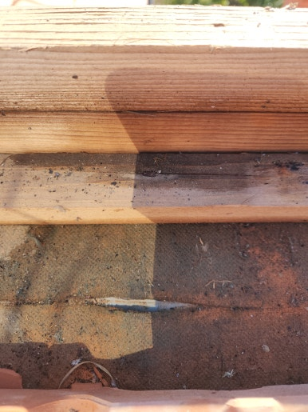
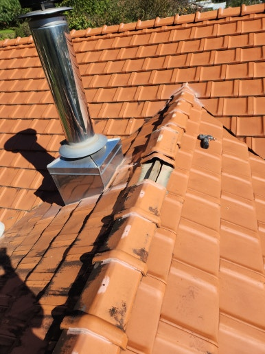
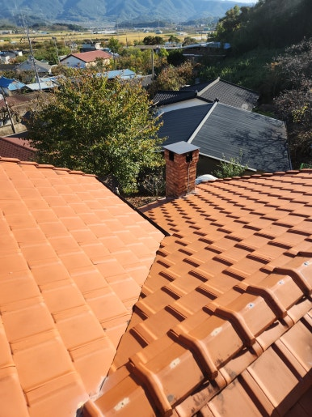
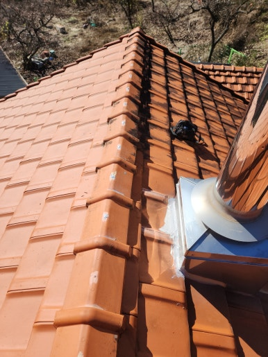

기와지붕의 수명과 건물 안전을 유지하기 위해서는 빗물이 원활하게 배출되도록 물받이와 배수로를 정기적으로 관리하는 것이 필수적입니다. 물받이가 노후되거나 손상되면 폭우 시 빗물이 넘쳐 건물 외벽과 내부 누수로 이어질 수 있습니다.

특히 한옥 및 기와 주택은 지붕의 경사와 기와 배치가 빗물 흐름에 직접적인 영향을 미치므로, 물받이 설치 시 정확한 수평 맞춤과 연결 부위 마감이 매우 중요합니다. 이번 현장 역시 기존 물받이 상태를 점검한 뒤, 빗물이 막힘없이 배출될 수 있도록 신규 물받이 교체 및 배수로 보수 작업을 진행했습니다.

지붕 전체의 빗물 흐름을 파악하여 맞춤형 물받이를 구획에 맞게 설치하고 마감 처리를 깔끔하게 완료했습니다.

<h2>기와지붕 물받이 공사가 필요한 이유</h2>

- 비가 올 때 물받이 선틀이나 연결 부위에서 물이 새는 경우
 
- 물받이가 오래되어 녹슬거나 처지고 변형된 경우
 
- 낙엽 및 이물질이 쌓여 빗물이 넘쳐 흘러내리는 경우
 
- 빗물이 외벽을 타고 내려가 외벽 손상이나 착색을 유발하는 경우
 
- 지붕 처마 끝 누수로 인해 내부 천장까지 영향을 미치는 경우

<h2>지붕 물받이 공사 작업 과정</h2>

1. 현장 점검 및 구획 측정 (지붕 경사 및 기존 물받이 상태 확인)
 
2. 기존 철거 및 이물질 제거 (노후 물받이 및 주변 오물 정리)
 
3. 맞춤 물받이 제작 및 설치 (현장 규격에 맞춘 물받이 고정)
 
4. 홈통 및 연결 부위 보강 (이음새 코킹 실란트 작업 및 마감)
 
5. 최종 통수 점검 및 정리 (빗물 배수 흐름 및 시공태 확인)

이번 가창면 작업은 약 5~6시간 내외 소요되어
당일 시공을 차질 없이 완료했습니다.

<h2>물받이 공사 후 기대 효과</h2>

✔ 폭우 시에도 빗물이 원활하게 아래로 배출 
✔ 외벽 및 처마 부근으로의 빗물 넘침 차단 
✔ 물받이 연결 부위 고정 강화로 장기 누수 방지 
✔ 건물 외관을 깔끔하게 유지하여 정돈된 인상 제공 
✔ 지붕 구조물의 부식 방지 및 내구성 향상에 도움

<h2>이런 경우 꼭 점검해 보세요</h2>

✔ 비가 조금만 와도 물받이 밖으로 물이 떨어지는 경우 
✔ 물받이가 아래로 기울어지거나 고정대가 떨어진 경우 
✔ 처마 밑이나 외벽에 물 얼룩 및 곰팡이가 생기는 경우 
✔ 장기간 점검을 하지 않아 이물질로 막혀있는 경우 
✔ 태풍이나 폭우 후 물받이 훼손이 우려되는 경우

<h3 style="margin:0 0 12px 0;">
📌 더 자세한 시공 사례
</h3>

시공 과정과 작업 전후 사진은
네이버 블로그에서
더 자세하게 확인하실 수 있습니다.

<a href="https://blog.naver.com/house_surri/224460248948"
target="_blank"
rel="noopener"
style="
display:inline-block;
background:#03C75A;
color:#fff;
text-decoration:none;
padding:12px 22px;
border-radius:8px;
font-weight:700;">
네이버 블로그에서 자세히 보기 →
</a>

<h2>시공 문의</h2>

기와지붕 물받이·배수로 교체 / 노후 물받이 수리 및 보강 / 지붕 누수 점검 및 방수 시공 / 각종 지붕 구조물 보수

전화 • 문자 • 카톡

편하게 문의하세요.

