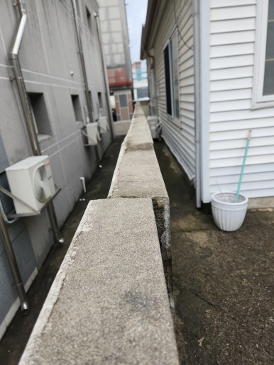
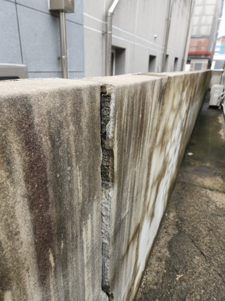
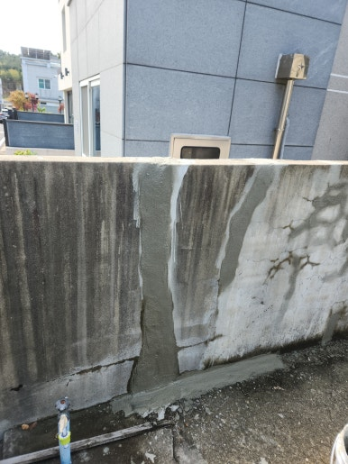
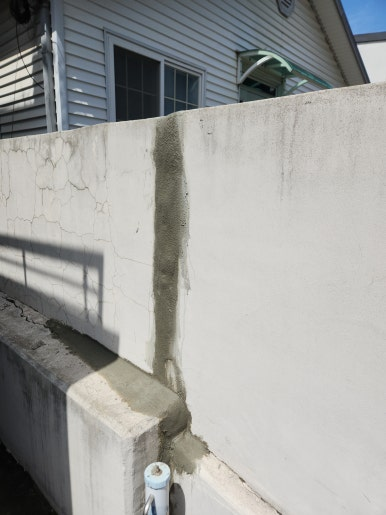

주택 외부 담장은 사계절 내내 비바람과 온도 변화에 지속적으로 노출되기 때문에 시간이 지나면 균열이 발생하거나 표면 미장 부분이 손상될 수 있습니다. Damaged wall sections without timely maintenance can lead to rain infiltration and structural deterioration.

이번 강원도 영월군 현장은 담장 표면에 크고 작은 균열이 발생하고 미장 부분이 들떠 있어 보수 작업이 필요한 상태였습니다. 손상된 미장 부위를 깨끗이 정리한 후 균열 충전 보강 및 깔끔한 면 마감 작업을 진행했습니다.

담장의 전체적인 균열 상태를 점검하고, 보강 및 미장 작업을 통해 주변과 자연스럽게 어우러지도록 마감했습니다.

<h2>담장 보수 공사가 필요한 이유</h2>

- 담장 표면에 가로 또는 세로 균열이 발생한 경우
 
- 벽면 미장 부분이 갈라지거나 떨어져 나가는 경우
 
- 비가 온 뒤 담장 내부로 빗물이 스며드는 경우
 
- 담장 모서리나 연결 부위가 파손된 경우
 
- 오래된 담장의 표면이 부식되고 손상된 경우

<h2>갈라진 담장 보수 작업 과정</h2>

1. 현장 점검 (담장 균열 및 파손 상태 정밀 확인)
 
2. 손상 부위 정리 (갈라지고 들뜬 미장 표면 제거)
 
3. 균열 보강 작업 (균열 부위 전용 보수재 충전)
 
4. 미장 및 면 정리 (주변 벽면과 매끄럽게 마감)
 
5. 최종 점검 (마감 상태 확인 및 주변 현장 정리)

이번 영월군 작업은 약 6시간 내외 소요되어
당일 작업을 차질 없이 완료했습니다.

<h2>담장 보수 후 기대 효과</h2>

✔ 갈라진 담장 균열 부위 확실한 보강 
✔ 손상된 표면 정비로 외관 미관 대폭 개선 
✔ 빗물 침투로 인한 내부 습기 및 추가 파손 예방 
✔ 담장 미장 상태 및 표면 내구성 향상 
✔ 외부 시설물의 안정적인 유지관리 지원

<h2>이런 경우 꼭 점검해 보세요</h2>

✔ 담장 벽면에 길게 금이 간 경우 
✔ 미장한 부분이 떨어져 나가는 경우 
✔ 담장 모서리가 깨지거나 파손된 경우 
✔ 비가 온 뒤 균열 부위에 물기가 생기는 경우 
✔ 오래된 담장 표면이 심하게 손상된 경우

<h3 style="margin:0 0 12px 0;">
📌 더 자세한 시공 사례
</h3>

시공 과정과 작업 전후 사진은
네이버 블로그에서
더 자세하게 확인하실 수 있습니다.

<a href="https://blog.naver.com/house_surri/224461473704"
target="_blank"
rel="noopener"
style="
display:inline-block;
background:#03C75A;
color:#fff;
text-decoration:none;
padding:12px 22px;
border-radius:8px;
font-weight:700;">
네이버 블로그에서 자세히 보기 →
</a>

<h2>시공 문의</h2>

주택 담장 균열 및 파손 보수 / 갈라진 담장 미장 및 정비 / 노후 담장 보수 및 외부 시설물 수리

전화 • 문자 • 카톡

편하게 문의하세요.

