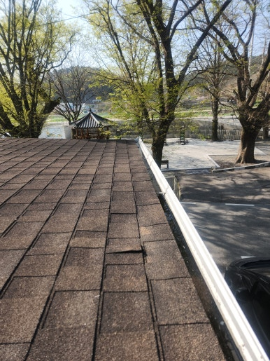
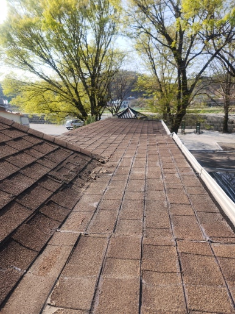
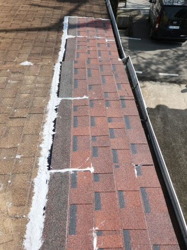
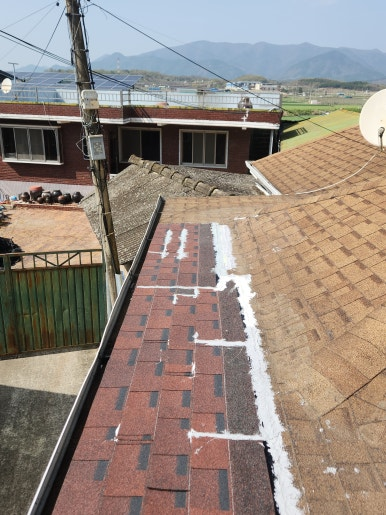

주택의 지붕은 사계절 내내 햇빛과 비바람에 직접적으로 노출되기 때문에 시간이 지나면서 방수 성능이 저하되거나 표면 손상이 발생할 수 있습니다. 특히 슁글지붕은 이음새나 연결 부위에 틈새가 생기면 빗물이 내부로 유입되어 실내 누수나 구조물 부식으로 이어지기 쉽습니다.

이번 대구 달서구 현장은 기존 슁글지붕의 노후화로 인해 방수 기능이 떨어져 보수 시공이 필요한 상태였습니다. 지붕의 전체적인 상태를 정밀 점검한 후 취약 부위를 보강하고 깔끔하게 방수재 도포 작업을 완료했습니다.

지붕 전체의 노후 상태를 확인한 후, 이물질 제거 및 이음새 방수 처리 작업을 거쳐 깔끔한 마감을 진행했습니다.

<h2>슁글지붕 방수가 필요한 이유</h2>

- 슁글 표면이 갈라지거나 부식된 경우
 
- 지붕 이음새 부분이 들뜨거나 벌어진 경우
 
- 비가 오면 천장이나 벽면에 누수가 발생하는 경우
 
- 지붕 방수층이 노후되어 기능이 떨어진 경우
 
- 지붕 곳곳에 균열이나 손상 부위가 확인되는 경우

<h2>슁글지붕 방수 작업 과정</h2>

1. 현장 점검 (지붕 전체 상태 및 누수 의심 부위 정밀 확인)
 
2. 표면 정리 (이물질 제거 및 손상 부위 정비)
 
3. 취약 부위 보강 (지붕 이음새와 틈새 방수 처리)
 
4. 방수 작업 (현장에 적합한 방수재 도포 및 시공)
 
5. 최종 점검 (방수 마감 상태 확인 및 주변 현장 정리)

이번 대구 달서구 작업은 약 5~6시간 내외 소요되어
당일 작업을 차질 없이 완료했습니다.

<h2>슁글지붕 방수 후 기대 효과</h2>

✔ 노후된 슁글지붕의 방수 성능 완벽 보완 
✔ 지붕 연결 부위 및 취약 부분 집중 보강 
✔ 빗물 유입으로 인한 실내 누수 및 구조물 손상 예방 
✔ 지붕 표면의 유지관리 및 내구성 대폭 향상 
✔ 주택 전반의 안전성 및 관리 편의성 개선

<h2>이런 경우 꼭 점검해 보세요</h2>

✔ 비가 온 뒤 천장에 물 자국이 생기는 경우 
✔ 슁글 표면이 갈라지거나 떨어지는 경우 
✔ 지붕 연결 부위가 벌어져 있는 경우 
✔ 지붕 일부가 들뜨거나 파손된 경우 
✔ 오래된 주택으로 지붕 방수가 걱정되는 경우

<h3 style="margin:0 0 12px 0;">
📌 더 자세한 시공 사례
</h3>

시공 과정과 작업 전후 사진은
네이버 블로그에서
더 자세하게 확인하실 수 있습니다.

<a href="https://blog.naver.com/house_surri/224462671671"
target="_blank"
rel="noopener"
style="
display:inline-block;
background:#03C75A;
color:#fff;
text-decoration:none;
padding:12px 22px;
border-radius:8px;
font-weight:700;">
네이버 블로그에서 자세히 보기 →
</a>

<h2>시공 문의</h2>

주택 슁글지붕 방수 및 보수 / 노후 지붕 방수 시공 / 지붕 누수 및 균열 보수 / 지붕 파손 부위 정비

전화 • 문자 • 카톡

편하게 문의하세요.

