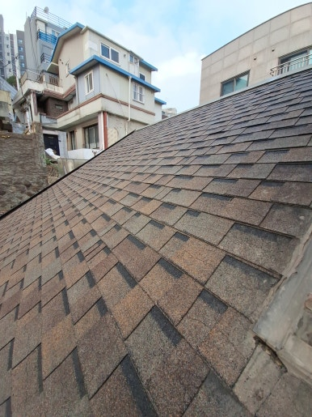
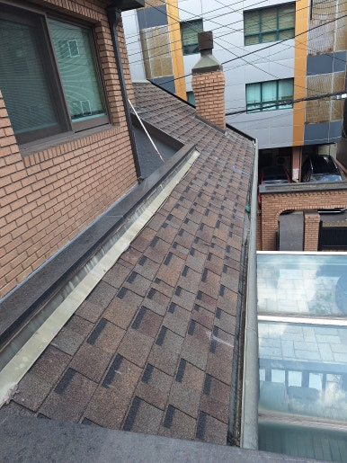
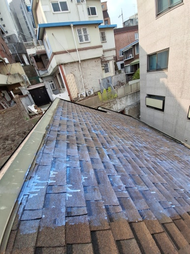
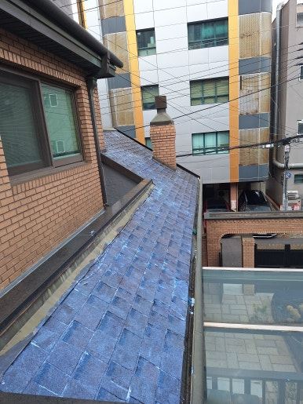

주택, 아파트, 공장, 상가 등 각종 시설물 보수부터 지붕 방수, 외벽 보수, 누수 공사까지 현장 상태에 맞춰 문제를 확실하게 해결해 드리는 집수리남입니다.

오늘은 대구 달서구 주택 슁글지붕 누수 방수 작업 현장을 소개해 드리겠습니다. 노후된 슁글지붕의 방수 기능 저하로 인해 누수 예방을 위한 방수작업을 진행했습니다.

햇빛과 비바람에 오랫동안 노출된 슁글은 갈라짐이나 들뜸, 이음새 틈새 등이 발생해 빗물 유입과 누수로 이어질 수 있습니다. 현장 점검을 통해 취약 부위를 확인하고 꼼꼼하게 보수 작업을 진행했습니다.

<h2>슁글지붕 누수 방수가 필요한 이유</h2>

- 슁글 표면이 갈라지거나 손상된 경우
 
- 지붕 겹침 부분이 들뜨거나 벌어진 경우
 
- 비가 내린 후 천장에 물 자국이 생기는 경우
 
- 지붕 연결 부위에서 누수가 의심되는 경우
 
- 오래된 주택으로 방수 기능이 저하된 경우

<h2>슁글지붕 누수 방수 작업 과정</h2>

1. 현장 점검 (지붕 전체 상태와 누수 의심 부위 확인)
 
2. 표면 정리 (이물질 제거 및 손상 부위 정비)
 
3. 취약 부위 보강 (지붕 이음새와 틈새 방수 처리)
 
4. 방수 시공 (현장 상태에 적합한 방수재 도포 및 마감)
 
5. 최종 점검 (시공 상태 확인 및 주변 정리)

이번 작업은 약 5시간 내외 소요되어
당일 작업을 차질 없이 완료하였습니다.

<h2>작업 후 개선 효과</h2>

✔ 노후된 슁글지붕의 방수 기능 보완 
✔ 지붕 이음새 및 틈새 방수 보강 
✔ 빗물 유입과 누수 발생 위험 감소에 도움 
✔ 지붕 손상 부위 추가 피해 예방 
✔ 주택 지붕의 유지관리 및 내구성 개선

<h2>이런 증상이 있다면 점검해 보세요!</h2>

✔ 비가 오면 천장이나 벽면에 물 자국이 생기는 경우 
✔ 슁글 표면이 갈라지거나 떨어지는 경우 
✔ 지붕 연결 부위가 벌어져 있는 경우 
✔ 지붕 일부가 들뜨거나 파손된 경우 
✔ 오래된 주택으로 지붕 누수가 걱정되는 경우

<h3 style="margin:0 0 12px 0;">
📌 더 자세한 시공 사례
</h3>

시공 과정과 작업 전후 사진은
네이버 블로그에서
더 자세하게 확인하실 수 있습니다.

<a href="https://blog.naver.com/house_surri/224463985005"
target="_blank"
rel="noopener"
style="
display:inline-block;
background:#03C75A;
color:#fff;
text-decoration:none;
padding:12px 22px;
border-radius:8px;
font-weight:700;">
네이버 블로그에서 자세히 보기 →
</a>

<h2>시공 문의 안내</h2>

슁글지붕 누수 및 방수 / 노후 지붕 보수 및 방수 시공 / 지붕 균열•파손 부위 보수 / 지붕 이음새 방수 보강

전화 • 문자 • 카톡

편하게 문의 주세요!

