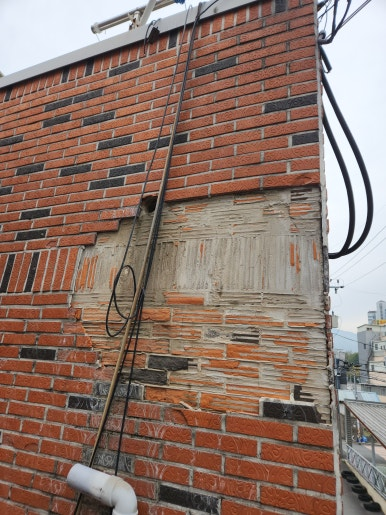
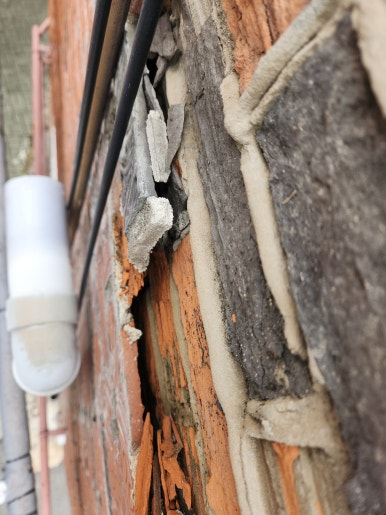
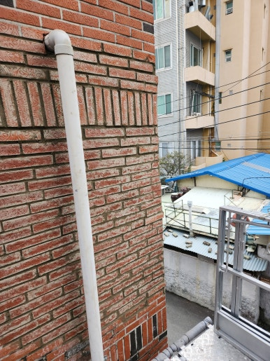
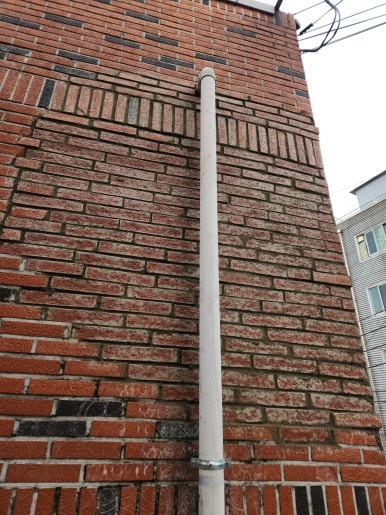

주택, 아파트, 공장, 상가 등 각종 시설물 보수부터 외벽 타일 보수, 균열 보수, 누수 공사까지 현장 상태에 맞춰 문제를 확실하게 해결해 드리는 집수리남입니다.

오늘은 대구 달서구 건물 외벽 타일 탈락 보수 작업 현장을 소개해 드리겠습니다. 노후화로 인해 탈락 및 들뜬 외벽 타일을 정비하여 안전하게 보수 작업을 진행했습니다.

건물 외벽 타일은 오랜 시간 햇빛과 비바람, 온도 변화 등에 노출되면서 접착력이 약해지거나 균열이 발생할 수 있습니다. 특히 타일이 들뜨거나 떨어지는 경우 보행자 안전에도 영향을 줄 수 있기 때문에 빠른 점검과 적절한 보수 작업이 중요합니다. 현장 상태를 꼼꼼하게 확인한 후 작업을 진행했습니다.

<h2>외벽 타일 탈락 보수가 필요한 이유</h2>

- 외벽 타일 일부가 떨어져 나간 경우
 
- 타일 표면에 균열이나 파손이 발생한 경우
 
- 타일이 들뜨거나 흔들리는 경우
 
- 타일 사이 줄눈이 갈라지거나 떨어진 경우
 
- 오래된 건물로 외벽 마감재가 노후된 경우

<h2>외벽 타일 탈락 보수 작업 과정</h2>

1. 현장 점검 (타일 탈락 부위 및 주변 상태 확인)
 
2. 손상 부위 정리 (파손 및 불량 부위 제거)
 
3. 바탕면 정비 (접착면 이물질 제거 및 바탕면 보강)
 
4. 타일 보수 시공 (적합한 자재를 사용해 타일 재부착 및 마감)
 
5. 최종 점검 (시공 상태 확인 및 주변 정리)

이번 작업은 약 6시간 내외 소요되어
당일 작업을 차질 없이 완료하였습니다.

<h2>작업 후 개선 효과</h2>

✔ 탈락된 외벽 타일 보수 및 복구 
✔ 손상된 외벽 마감 부위 정비 
✔ 추가적인 타일 탈락 위험 예방에 도움 
✔ 외벽의 미관 개선 
✔ 건물 외벽 유지관리 및 안전성 개선에 도움

<h2>이런 증상이 있다면 점검해 보세요!</h2>

✔ 건물 외벽 타일이 떨어져 나간 경우 
✔ 타일이 깨지거나 금이 간 경우 
✔ 외벽 타일을 두드렸을 때 빈 소리가 나는 경우 
✔ 타일 일부가 튀어나오거나 들뜬 경우 
✔ 오래된 건물로 외벽 보수가 필요한 경우

<h3 style="margin:0 0 12px 0;">
📌 더 자세한 시공 사례
</h3>

시공 과정과 작업 전후 사진은
네이버 블로그에서
더 자세하게 확인하실 수 있습니다.

<a href="https://blog.naver.com/house_surri/224465161484"
target="_blank"
rel="noopener"
style="
display:inline-block;
background:#03C75A;
color:#fff;
text-decoration:none;
padding:12px 22px;
border-radius:8px;
font-weight:700;">
네이버 블로그에서 자세히 보기 →
</a>

<h2>시공 문의 안내</h2>

외벽 타일 탈락 및 파손 보수 / 외벽 타일 균열•들뜸 보수 / 건물 외벽 및 시설물 보수

전화 • 문자 • 카톡

편하게 문의 주세요!

