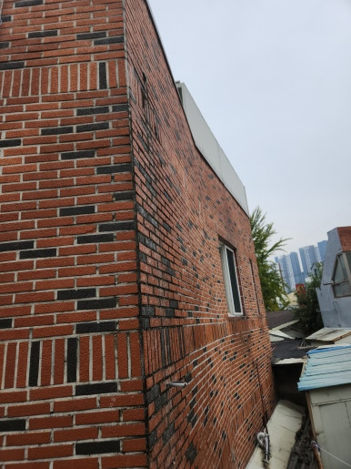
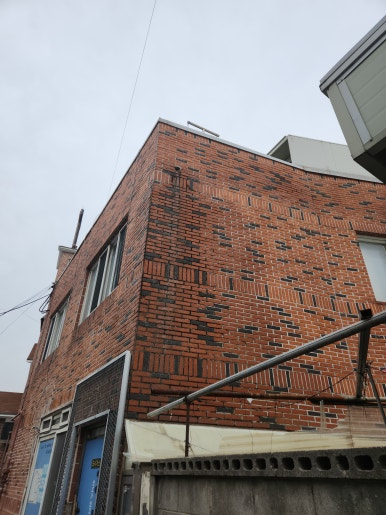
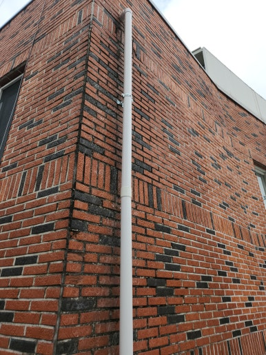
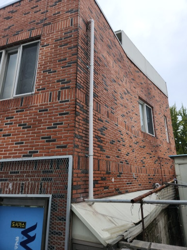

주택, 아파트, 공장, 상가 등 각종 시설물 보수부터 지붕 방수, 외벽 보수, 누수 공사까지 현장 상태에 맞춰 문제를 확실하게 해결해 드리는 집수리남입니다.

오늘은 대구 달서구 건물 우수관 설치 작업 현장을 소개해 드리겠습니다.  건물 외벽으로 빗물을 원활하게 배출하기 위해 우수관을 새롭게 설치한 현장입니다.

우수관은 옥상이나 지붕의 빗물을 지상 배수구까지 안전하게 배출하는 중요한 시설로 제대로 설치되지 않으면 외벽 오염이나 누수 등의 문제가 발생할 수 있습니다.  이번 현장에서는 건물 구조와 설치 위치를 꼼꼼히 확인한 후 원활한 빗물 배수를 위해 현장에 적합한 우수관 설치 작업을 진행했습니다.

<h2>우수관 설치가 필요한 이유</h2>

- 건물 외벽에 빗물이 그대로 흘러내리는 경우
 
- 기존 우수관이 파손되거나 노후된 경우
 
- 빗물 배수가 원활하지 않은 경우
 
- 우수관이 없어 외벽 오염이 심한 경우
 
- 신축 또는 증축 건물에 우수관 설치가 필요한 경우

<h2>우수관 설치 작업 과정</h2>

1. 현장 점검 (설치 위치 및 배수 경로 확인)
 
2. 자재 준비 (현장에 적합한 우수관 및 부속 자재 준비)
 
3. 설치 위치 작업 (배관 고정 위치 및 연결 부위 정리)
 
4. 우수관 설치 (배수 방향에 맞춰 우수관 연결 및 고정)
 
5. 마무리 점검 (연결 상태 및 빗물 배수 상태 확인)

이번 작업은 약 2시간 내외 소요되어
당일 작업을 차질 없이 완료하였습니다.

<h2>작업 후 개선 효과</h2>

✔ 건물 외벽 우수관 설치 완료 
✔ 빗물 배수 경로 확보 
✔ 외벽을 타고 흐르는 빗물 관리에 도움 
✔ 빗물로 인한 외벽 오염 예방에 도움 
✔ 건물 유지관리 및 배수 환경 개선

<h2>이런 증상이 있다면 점검해 보세요!</h2>

✔ 비가 오면 건물 외벽으로 빗물이 흘러내리는 경우 
✔ 기존 우수관이 깨지거나 파손된 경우 
✔ 우수관 연결 부위에서 물이 새는 경우 
✔ 빗물이 제대로 배출되지 않는 경우 
✔ 건물에 우수관을 새롭게 설치해야 하는 경우

<h3 style="margin:0 0 12px 0;">
📌 더 자세한 시공 사례
</h3>

시공 과정과 작업 전후 사진은
네이버 블로그에서
더 자세하게 확인하실 수 있습니다.

<a href="https://blog.naver.com/house_surri/224466463105"
target="_blank"
rel="noopener"
style="
display:inline-block;
background:#03C75A;
color:#fff;
text-decoration:none;
padding:12px 22px;
border-radius:8px;
font-weight:700;">
네이버 블로그에서 자세히 보기 →
</a>

<h2>시공 문의 안내</h2>

건물 우수관 설치 및 교체 / 외벽 배관•배수 시설 설치 / 누수 및 시설물 보수

전화 • 문자 • 카톡

편하게 문의 주세요!

