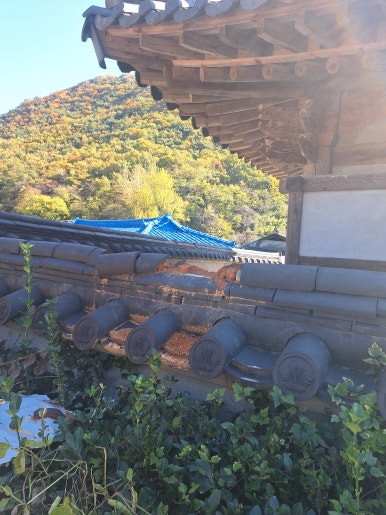
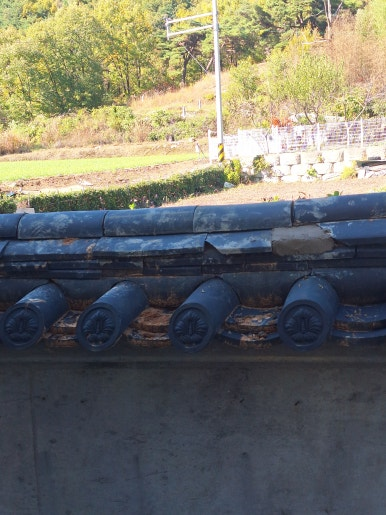
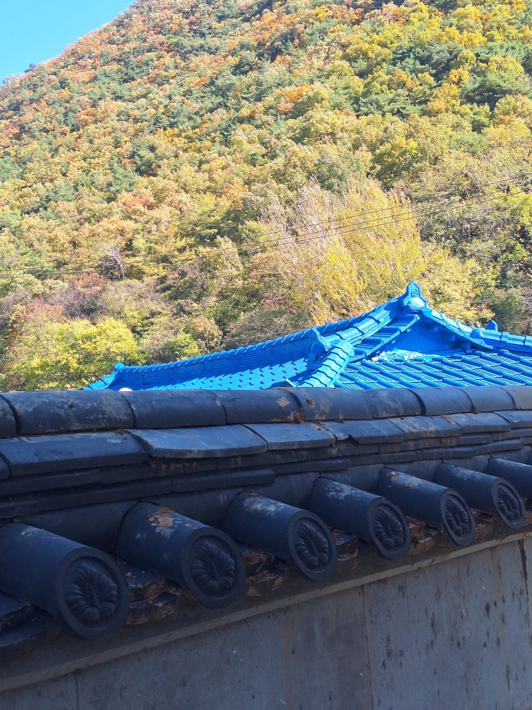
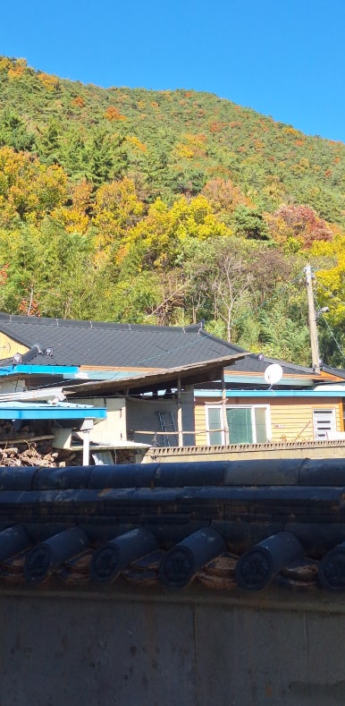

주택, 아파트, 공장, 상가 등 각종 시설물 보수부터 지붕 방수, 기와 보수, 외벽 보수, 누수 공사까지 현장 상태에 맞춰 문제를 확실하게 해결해 드리는 집수리남입니다.

오늘은 대구 동구 재실 깨진 기와 보수 작업 현장을 소개해 드리겠습니다.  외부 환경과 충격으로 손상된 지붕 기와를 보수한 현장입니다.

기와의 손상 상태와 지붕 전체를 꼼꼼히 점검한 후, 빗물 유입으로 인한 누수와 추가 피해를 예방하기 위해 손상된 부분을 중심으로 보수 작업을 진행했습니다. 기와는 작은 파손이라도 방치하면 빗물 유입으로 이어질 수 있어 미리 점검하고 보수하는 것이 중요합니다.

<h2>이런 경우 기와 보수가 필요합니다</h2>

- 지붕 기와가 깨지거나 금이 간 경우
 
- 기와가 밀리거나 제자리에서 이탈한 경우
 
- 비가 온 뒤 천장이나 지붕 내부에 누수가 발생하는 경우
 
- 오래된 기와가 노후되어 손상된 경우
 
- 강풍이나 외부 충격으로 기와가 파손된 경우

<h2>깨진 기와 보수 작업 과정</h2>

1. 현장 점검 (지붕 상태 및 깨진 기와 위치 확인)
 
2. 파손 기와 확인 (손상된 기와와 주변 상태 점검)
 
3. 파손 기와 정리 (깨진 기와 제거 및 설치 부위 정리)
 
4. 기와 보수 작업 (새로운 기와 설치 및 위치 고정)
 
5. 마무리 점검 (기와 고정 상태 및 주변 마감 확인)

이번 작업은 약 5시간 내외 소요되어
당일 작업을 차질 없이 완료하였습니다.

<h2>작업 후 개선 효과</h2>

✔ 깨진 기와 보수 및 교체 완료 
✔ 손상된 지붕 마감 부분 개선 
✔ 빗물 유입 가능성 감소에 도움 
✔ 지붕 기와의 안정적인 상태 유지 
✔ 건물 지붕 유지관리 및 보호에 도움

<h2>이런 증상이 있다면 점검해 보세요!</h2>

✔ 지붕에 깨진 기와가 보이는 경우 
✔ 기와가 한쪽으로 밀려 있는 경우 
✔ 비가 오면 천장에서 물이 떨어지는 경우 
✔ 오래된 지붕 기와가 갈라지거나 부서진 경우 
✔ 강풍이나 태풍 이후 기와 손상이 의심되는 경우

<h3 style="margin:0 0 12px 0;">
📌 더 자세한 시공 사례
</h3>

시공 과정과 작업 전후 사진은
네이버 블로그에서
더 자세하게 확인하실 수 있습니다.

<a href="https://blog.naver.com/house_surri/224467679587"
target="_blank"
rel="noopener"
style="
display:inline-block;
background:#03C75A;
color:#fff;
text-decoration:none;
padding:12px 22px;
border-radius:8px;
font-weight:700;">
네이버 블로그에서 자세히 보기 →
</a>

<h2>시공 문의 안내</h2>

기와 보수 및 교체 / 지붕 누수 및 방수 / 각종 시설물 보수

전화 • 문자 • 카톡

편하게 문의 주세요!

