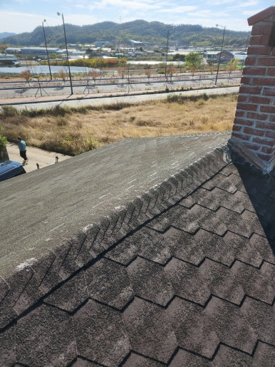
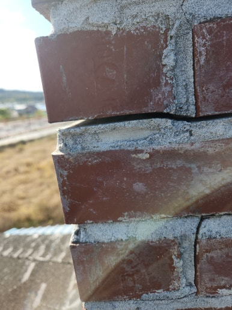
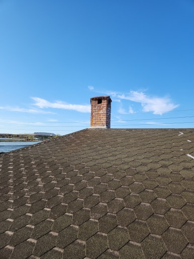
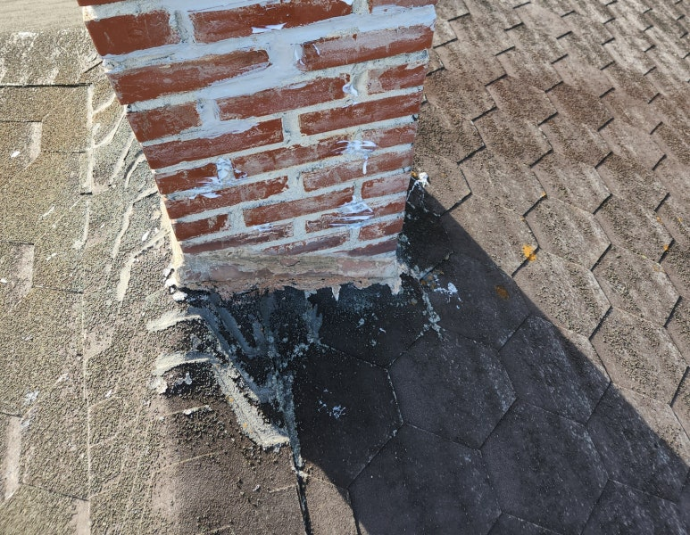

주택, 아파트, 공장, 상가 등 각종 시설물 보수부터 지붕 방수, 외벽 보수, 누수 공사까지 현장 상태에 맞춰 문제를 확실하게 해결해 드리는 집수리남입니다.

오늘은 대구 북구 주택 슁글지붕 누수 방수 작업 현장을 소개해 드리겠습니다.  노후된 슁글지붕의 들뜸과 갈라짐으로 인한 누수를 방지하기 위해 방수 보수 작업을 진행한 현장입니다.

노후된 슁글지붕이 햇빛과 비바람에 장기간 노출되면서 들뜸과 갈라짐 등으로 누수 우려가 있는 현장이었습니다. 지붕 전체와 누수 의심 부위를 꼼꼼히 점검한 후 문제가 발생할 수 있는 부분을 중심으로 방수 보수 작업을 진행했습니다. 슁글지붕은 작은 틈이나 손상도 빗물 유입의 원인이 될 수 있어 정확한 원인 파악과 보수가 중요합니다.

<h2>이런 경우 슁글지붕 방수가 필요합니다</h2>

- 비가 온 뒤 천장에 물 자국이 생기는 경우
 
- 슁글이 들뜨거나 갈라진 경우
 
- 지붕 연결 부위에 틈이 발생한 경우
 
- 오래된 지붕에서 반복적으로 누수가 발생하는 경우
 
- 강풍이나 태풍 이후 지붕 손상이 의심되는 경우

<h2>슁글지붕 누수방수 작업 과정</h2>

1. 현장 점검 (지붕 전체 상태 및 누수 의심 부위 확인)
 
2. 손상 부위 확인 (슁글 들뜸과 갈라짐, 틈새 점검)
 
3. 보수 작업 준비 (이물질 제거 및 방수 시공 부위 정리)
 
4. 방수 시공 (손상 부위 보수 및 방수 처리 진행)
 
5. 마무리 점검 (시공 상태와 주변 마감 상태 확인)

이번 작업은 약 4~5시간 내외 소요되어
당일 작업을 차질 없이 완료하였습니다.

<h2>작업 후 개선 효과</h2>

✔ 슁글지붕 손상 부위 보수 완료 
✔ 누수 취약 부위 방수 처리 
✔ 지붕 틈새를 통한 빗물 유입 예방에 도움 
✔ 노후된 지붕의 유지관리 개선 
✔ 추가적인 누수 피해 예방에 도움

<h2>이런 증상이 있다면 점검해 보세요!</h2>

✔ 비가 오면 천장에서 물이 떨어지는 경우 
✔ 천장이나 벽면에 누수 자국이 생긴 경우 
✔ 슁글이 들뜨거나 떨어져 나간 경우 
✔ 지붕 곳곳에 갈라짐이나 틈새가 보이는 경우 
✔ 오래된 주택이라 지붕 방수가 걱정되는 경우

<h3 style="margin:0 0 12px 0;">
📌 더 자세한 시공 사례
</h3>

시공 과정과 작업 전후 사진은
네이버 블로그에서
더 자세하게 확인하실 수 있습니다.

<a href="https://blog.naver.com/house_surri/224468566846"
target="_blank"
rel="noopener"
style="
display:inline-block;
background:#03C75A;
color:#fff;
text-decoration:none;
padding:12px 22px;
border-radius:8px;
font-weight:700;">
네이버 블로그에서 자세히 보기 →
</a>

<h2>시공 문의 안내</h2>

슁글지붕 방수 및 보수 / 지붕 누수 공사 / 기와 보수 및 교체 / 각종 시설물 보수

전화 • 문자 • 카톡

편하게 문의 주세요!

