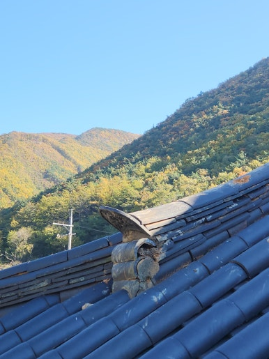
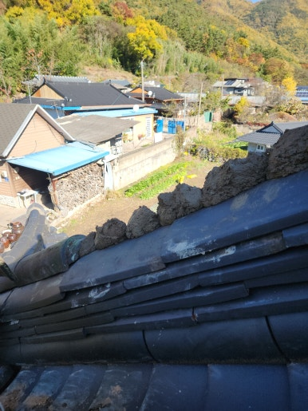
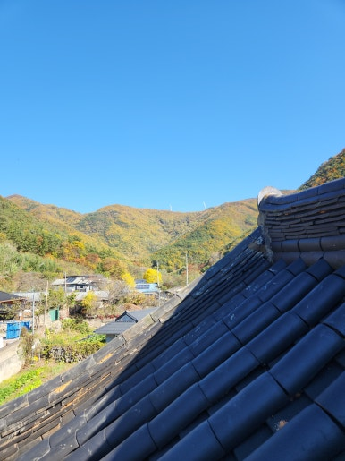
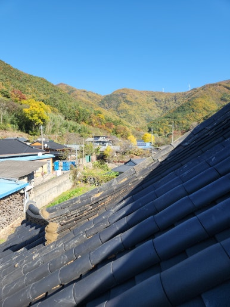

주택, 아파트, 공장, 상가 등 각종 시설물 보수부터 지붕 방수, 외벽 보수, 누수 공사까지 현장 상태에 맞춰 문제를 확실하게 해결해 드리는 집수리남입니다.

오늘은 대구 달서구 주택 기와지붕 기와 보수 작업 현장을 소개해 드리겠습니다.  오랜 시간 비바람과 햇빛에 노출되어 어긋나고 들뜬 기와를 정리하고 손상된 기와를 보수한 현장입니다.

오랜 시간 비바람과 햇빛에 노출되면서 기와가 어긋나고 들뜨는 등 지붕 손상이 확인된 현장이었습니다. 현장 도착 후 지붕 전체 상태를 꼼꼼히 점검하고 손상된 기와와 보수가 필요한 부분을 중심으로 작업을 진행했습니다. 기와의 작은 틈도 누수로 이어질 수 있어 주변 기와 상태까지 세심하게 확인했습니다.

<h2>이런 경우 기와지붕 보수가 필요합니다</h2>

- 기와가 깨지거나 금이 간 경우
 
- 기와가 한쪽으로 밀리거나 들뜬 경우
 
- 비가 온 뒤 천장이나 벽면에 누수 자국이 생기는 경우
 
- 지붕 가장자리 기와가 흔들리거나 이탈한 경우
 
- 오래된 주택이라 기와지붕 점검이 필요한 경우

<h2>기와지붕 기와 보수 작업 과정</h2>

1. 현장 점검 (지붕 전체 상태와 기와 손상 여부 확인)
 
2. 손상 부위 확인 (깨짐, 들뜸, 이탈된 기와 확인)
 
3. 보수 작업 준비 (손상 부위 주변 정리 및 작업 준비)
 
4. 기와 보수 작업 (손상된 기와 교체 및 어긋난 기와 정리)
 
5. 마무리 점검 (기와 고정 상태와 주변 마감 상태 확인)

이번 작업은 약 5~6시간 내외 소요되어
당일 작업을 차질 없이 완료하였습니다.

<h2>작업 후 개선 효과</h2>

✔ 깨지거나 손상된 기와 보수 완료 
✔ 어긋나고 들뜬 기와 정리 
✔ 지붕 틈새를 통한 빗물 유입 예방에 도움 
✔ 기와 이탈 및 추가 손상 위험 감소에 도움 
✔ 노후된 지붕의 유지관리 상태 개선

<h2>이런 증상이 있다면 점검해 보세요!</h2>

✔ 비가 오면 천장에서 물이 떨어지는 경우 
✔ 천장이나 벽면에 물 자국이 생기는 경우 
✔ 지붕 위 기와가 깨져 있는 경우 
✔ 기와가 들뜨거나 아래로 밀려 있는 경우 
✔ 강풍이나 태풍 이후 지붕 손상이 의심되는 경우

<h3 style="margin:0 0 12px 0;">
📌 더 자세한 시공 사례
</h3>

시공 과정과 작업 전후 사진은
네이버 블로그에서
더 자세하게 확인하실 수 있습니다.

<a href="https://blog.naver.com/house_surri/224469472121"
target="_blank"
rel="noopener"
style="
display:inline-block;
background:#03C75A;
color:#fff;
text-decoration:none;
padding:12px 22px;
border-radius:8px;
font-weight:700;">
네이버 블로그에서 자세히 보기 →
</a>

<h2>시공 문의 안내</h2>

기와지붕 기와 보수 및 교체 / 지붕 누수 점검 및 방수 공사 / 주택 및 각종 건물 시설물 수리

전화 • 문자 • 카톡

편하게 문의 주세요!

