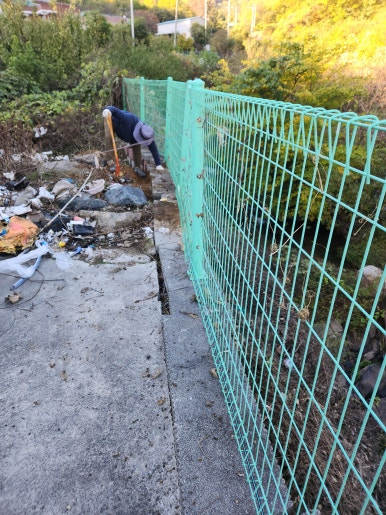
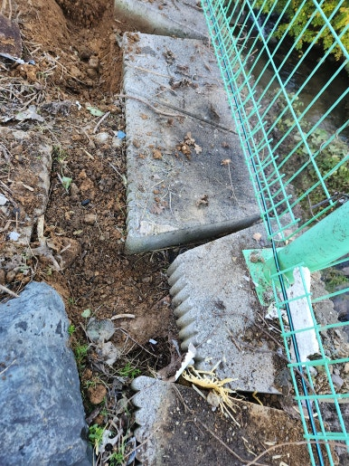
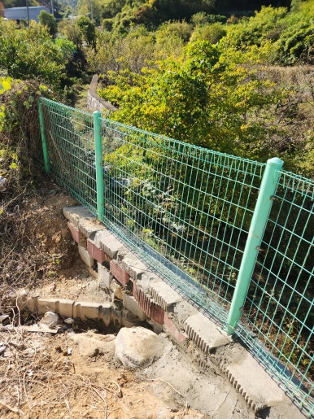
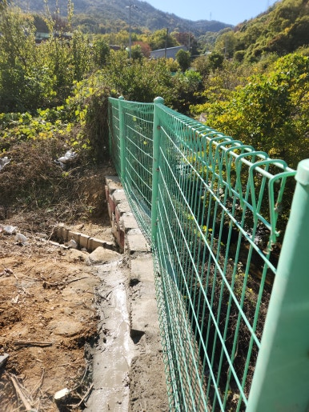

주택, 아파트, 공장, 상가 등 각종 시설물 보수부터 펜스 설치 및 보수, 외벽 보수, 누수 공사까지 현장 상태에 맞춰 문제를 확실하게 해결해 드리는 집수리남입니다.

오늘은 대구 달성군 노후된 철망 펜스 보수 작업 현장을 소개해 드리겠습니다.  오랜 시간 외부 환경에 노출되어 노후되고 손상된 철망 펜스를 꼼꼼하게 보수한 현장입니다.

비바람과 햇빛, 습기 등 오랜 외부 환경 노출로 인해 철망이 늘어지거나 약해진 부분이 확인되었습니다. 현장 도착 후 상태를 상세히 점검하고 기존 구조물을 최대한 활용하여 손상된 부위를 중심으로 보수를 진행했습니다.

<h2>이런 경우 철망 펜스 보수가 필요합니다</h2>

- 철망이 찢어지거나 끊어진 경우
 
- 펜스가 한쪽으로 기울어져 있는 경우
 
- 철망이 늘어지거나 처진 경우
 
- 기둥이나 연결 부위가 흔들리는 경우
 
- 오래된 펜스의 부식 및 파손이 진행된 경우

<h2>철망 펜스 보수 작업 과정</h2>

1. 현장 점검 (기존 펜스 전체 상태와 손상 부위 확인)
 
2. 보수 부위 정리 (파손된 철망과 주변 장애물 정리)
 
3. 고정 상태 확인 (기둥 및 연결 부위 흔들림 점검)
 
4. 철망 펜스 보수 (손상 부위 보강 및 철망 정리·고정 작업)
 
5. 마무리 점검 (전체 고정 상태와 주변 마감 상태 확인)

이번 작업은 약 7~8시간 내외 소요되어
당일 작업을 차질 없이 완료하였습니다.

<h2>작업 후 개선 효과</h2>

✔ 손상된 철망 펜스 보수 완료 
✔ 늘어지고 불안정한 철망 정리 
✔ 펜스 고정 상태 개선 
✔ 추가적인 파손 및 이탈 위험 감소에 도움 
✔ 노후된 시설물의 유지관리 상태 개선

<h2>이런 경우 꼭 필요합니다!</h2>

✔ 철망이 늘어져 바닥 쪽으로 처지는 경우 
✔ 펜스 기둥이 흔들리거나 기울어진 경우 
✔ 철망이 찢어지거나 연결 부위가 떨어진 경우 
✔ 오래되어 녹이 슬고 부식이 진행된 경우 
✔ 강풍이나 외부 충격으로 펜스가 손상된 경우

<h3 style="margin:0 0 12px 0;">
📌 더 자세한 시공 사례
</h3>

시공 과정과 작업 전후 사진은
네이버 블로그에서
더 자세하게 확인하실 수 있습니다.

<a href="https://blog.naver.com/house_surri/224470736286"
target="_blank"
rel="noopener"
style="
display:inline-block;
background:#03C75A;
color:#fff;
text-decoration:none;
padding:12px 22px;
border-radius:8px;
font-weight:700;">
네이버 블로그에서 자세히 보기 →
</a>

<h2>시공 문의 안내</h2>

철망 펜스 보수 및 교체 / 노후 펜스 보강 및 설치 / 주택·공장·상가 시설물 수리

전화 • 문자 • 카톡

편하게 문의 주세요!

