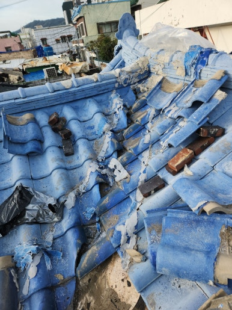
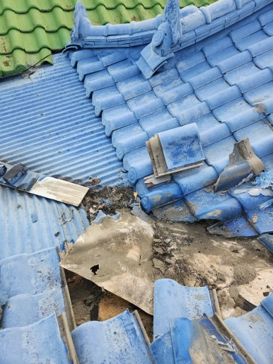
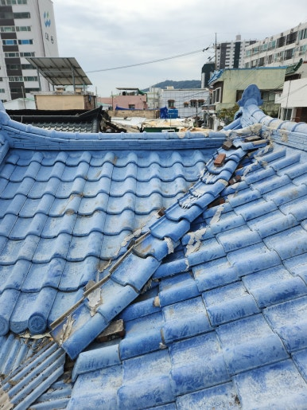
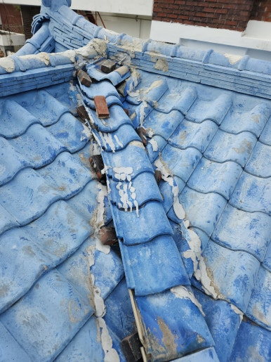

주택, 아파트, 공장, 상가 등 각종 시설물 보수부터 지붕 방수, 외벽 보수, 누수 공사까지 현장 상태에 맞춰 문제를 확실하게 해결해 드리는 집수리남입니다.

오늘은 대구 서구 기와지붕 누수 방수 작업 현장을 소개해 드리겠습니다.  오랜 시간 외부 환경에 노출되어 기와지붕에서 누수가 발생한 현장입니다.

기와지붕은 비바람과 햇빛, 온도 변화 등으로 인해 기와가 밀리거나 틈이 생길 수 있으며, 시간이 지나면서 연결 부위와 방수층이 약해져 빗물이 내부로 유입되는 문제가 발생할 수 있습니다. 지붕 상태를 꼼꼼히 점검한 후 누수 취약 부위를 중심으로 방수 작업을 진행했습니다.

<h2>이런 경우 기와지붕 방수 작업이 필요합니다</h2>

- 비가 오면 천장이나 벽면에 물이 스며드는 경우
 
- 지붕 기와가 깨지거나 밀려 있는 경우
 
- 기와 사이로 빗물이 유입되는 경우
 
- 지붕 연결 부위에 틈이나 균열이 발생한 경우
 
- 오래된 지붕으로 방수 기능이 저하된 경우

<h2>기와지붕 누수 방수 작업 과정</h2>

1. 현장 점검 (지붕 전체 상태 및 누수 의심 부위 확인)
 
2. 보수 부위 정리 (이물질 제거 및 손상 부위 정리)
 
3. 기와 상태 점검 (깨짐, 들뜸, 틈새 및 연결 부위 확인)
 
4. 방수 작업 진행 (누수 취약 부위 보강 및 방수 시공)
 
5. 마무리 점검 (시공 부위 및 전체 마감 상태 확인)

이번 작업은 약 5~6시간 내외 소요되어
당일 작업을 차질 없이 완료하였습니다.

<h2>작업 후 개선 효과</h2>

✔ 기와지붕 누수 취약 부위 보수 
✔ 빗물 유입 가능성이 있는 틈새 보강 
✔ 노후된 지붕의 방수 성능 개선에 도움 
✔ 추가적인 누수 및 시설물 손상 예방에 도움 
✔ 지붕 유지관리 상태 개선

<h2>이런 경우 꼭 필요합니다!</h2>

✔ 비가 올 때 천장에서 물이 떨어지는 경우 
✔ 지붕 기와가 깨지거나 어긋난 경우 
✔ 지붕에서 물이 스며드는 흔적이 발견된 경우 
✔ 오래된 기와지붕으로 누수가 걱정되는 경우 
✔ 장마철이나 집중호우 전 지붕 점검이 필요한 경우

<h3 style="margin:0 0 12px 0;">
📌 더 자세한 시공 사례
</h3>

시공 과정과 작업 전후 사진은
네이버 블로그에서
더 자세하게 확인하실 수 있습니다.

<a href="https://blog.naver.com/house_surri/224471804043"
target="_blank"
rel="noopener"
style="
display:inline-block;
background:#03C75A;
color:#fff;
text-decoration:none;
padding:12px 22px;
border-radius:8px;
font-weight:700;">
네이버 블로그에서 자세히 보기 →
</a>

<h2>시공 문의 안내</h2>

기와지붕 누수 보수 및 방수 공사 / 노후 지붕 보강 및 보수 작업 / 주택·공장·상가 각종 시설물 수리

전화 • 문자 • 카톡

편하게 문의 주세요!

