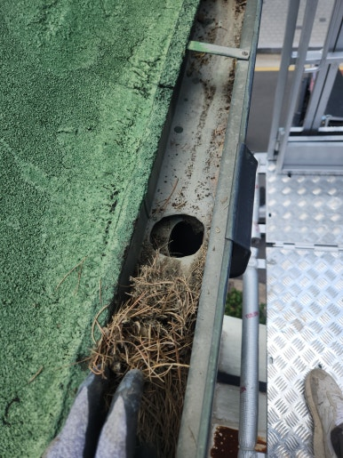
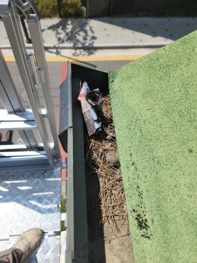
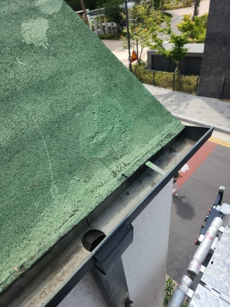
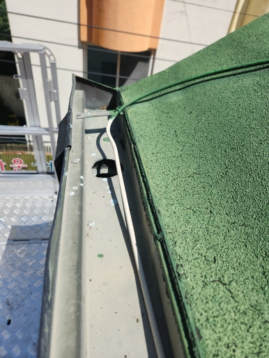

주택, 아파트, 공장, 상가 등 각종 시설물 보수부터 지붕 방수, 외벽 보수, 누수 공사까지 현장 상태에 맞춰 문제를 확실하게 해결해 드리는 집수리남입니다.

오늘은 대구 수성구 건물 빗물받이 청소 및 보수 작업 현장을 소개해 드리겠습니다.  빗물받이 내부에 낙엽과 흙먼지 등 각종 이물질이 쌓여 배수가 원활하지 않은 상태에서 보수 및 정비를 진행한 현장입니다.

빗물받이는 평소 눈에 잘 띄지 않지만 건물의 빗물 배수에 중요한 역할을 합니다. 전체 상태를 점검한 후 내부 이물질을 제거하고 손상된 부분을 보수하여 원활한 배수가 이루어지도록 작업을 진행했습니다.

<h2>이런 경우 빗물받이 청소 및 보수 작업이 필요합니다</h2>

- 빗물받이 내부에 낙엽과 이물질이 쌓인 경우
 
- 비가 오면 빗물받이에서 물이 넘치는 경우
 
- 배수구가 막혀 물이 원활하게 빠지지 않는 경우
 
- 빗물받이 연결 부위에 틈이나 누수가 발생한 경우
 
- 빗물받이 고정 상태가 불량하거나 노후된 경우

<h2>빗물받이 청소 및 보수 작업 과정</h2>

1. 현장 점검 (빗물받이 전체 상태 및 배수구 확인)
 
2. 이물질 제거 (낙엽, 흙먼지 및 내부 오염물 청소)
 
3. 배수 상태 확인 (배수구 막힘 및 물 흐름 점검)
 
4. 보수 작업 (손상 부위 및 연결 부위 보강)
 
5. 마무리 점검 (배수 상태 및 작업 부위 최종 확인)

이번 작업은 약 5시간 내외 소요되어
당일 작업을 차질 없이 완료하였습니다.

<h2>작업 후 개선 효과</h2>

✔ 빗물받이 내부 낙엽 및 각종 이물질 제거 
✔ 막혀 있던 배수구 청소로 배수 기능 개선 
✔ 손상된 연결 부위 보수 및 보강 
✔ 빗물 넘침으로 인한 외벽 오염 예방에 도움 
✔ 원활한 빗물 배수로 건물 유지관리 개선

<h2>이런 경우 꼭 필요합니다!</h2>

✔ 비가 오면 빗물받이에서 물이 넘치는 경우 
✔ 빗물받이 내부에 낙엽과 쓰레기가 많이 쌓인 경우 
✔ 배수구에서 물이 천천히 빠지는 경우 
✔ 빗물받이 연결 부위에서 물이 새는 경우 
✔ 오래된 빗물받이의 청소 및 보수가 필요한 경우

<h3 style="margin:0 0 12px 0;">
📌 더 자세한 시공 사례
</h3>

시공 과정과 작업 전후 사진은
네이버 블로그에서
더 자세하게 확인하실 수 있습니다.

<a href="https://blog.naver.com/house_surri/224474642025"
target="_blank"
rel="noopener"
style="
display:inline-block;
background:#03C75A;
color:#fff;
text-decoration:none;
padding:12px 22px;
border-radius:8px;
font-weight:700;">
네이버 블로그에서 자세히 보기 →
</a>

<h2>시공 문의 안내</h2>

빗물받이 청소 및 보수 작업 / 건물 외부 배수시설 점검 및 정비 / 지붕 및 옥상 배수구 청소

전화 • 문자 • 카톡

편하게 문의 주세요!

