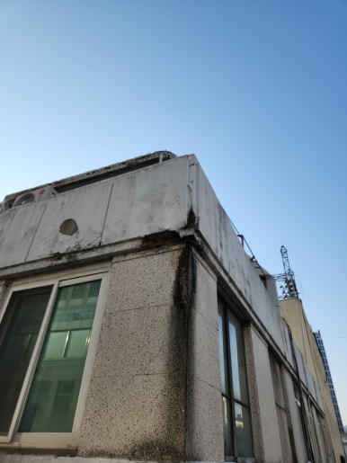
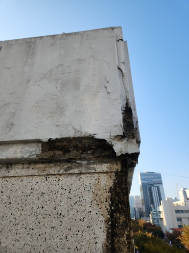
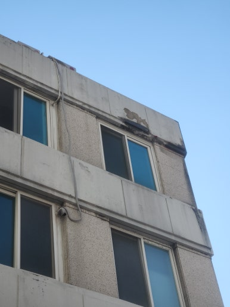
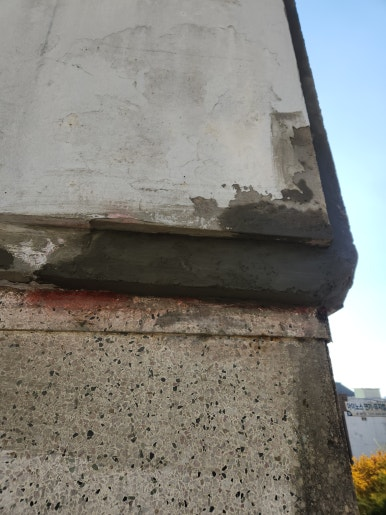

주택, 아파트, 공장, 상가 등 각종 시설물 보수부터 지붕 방수, 외벽 보수, 누수 공사까지 현장 상태에 맞춰 문제를 확실하게 해결해 드리는 집수리남입니다.

오늘은 대구 중구 건물 외벽 콘크리트 보수 작업 현장을 소개해 드리겠습니다.  건물 외벽의 노후된 콘크리트에 박리와 균열이 발생하여 손상 부위를 정리하고 보수재로 튼튼하게 복구한 현장입니다.

외벽 콘크리트 손상을 방치하면 콘크리트 탈락이나 누수 등 추가적인 문제가 발생할 수 있습니다. 손상 원인과 주변 상태를 면밀히 점검한 후 불량 부분을 충분히 제거하고 전용 보수재를 사용해 깔끔하게 복구했습니다.

<h2>이런 경우 외벽 콘크리트 보수 작업이 필요합니다</h2>

- 건물 외벽 콘크리트에 균열이 발생한 경우
 
- 콘크리트 표면이 부풀어 오르거나 떨어지는 경우
 
- 외벽 일부가 깨지거나 파손된 경우
 
- 오래된 건물 외벽의 노후화가 진행된 경우
 
- 콘크리트 손상으로 추가적인 누수가 우려되는 경우

<h2>외벽 콘크리트 보수 작업 과정</h2>

1. 현장 점검 (외벽 균열 및 콘크리트 손상 상태 확인)
 
2. 손상 부위 정리 (들뜬 콘크리트와 불량 부분 제거)
 
3. 바탕면 청소 (분진 및 이물질 제거 후 보수면 정리)
 
4. 콘크리트 보수 (전용 보수재를 사용하여 파손 부위 복구)
 
5. 마무리 점검 (보수 상태 및 주변 마감 상태 확인)

이번 작업은 약 5~6시간 내외 소요되어
당일 작업을 차질 없이 완료하였습니다.

<h2>작업 후 개선 효과</h2>

✔ 외벽 콘크리트 손상 부위 복구 
✔ 들뜨고 파손된 불량 콘크리트 정리 
✔ 균열 및 표면 손상 부위 보수 
✔ 추가적인 콘크리트 탈락 예방에 도움 
✔ 외벽 미관 개선 및 건물 유지관리 효과

<h2>이런 경우 꼭 필요합니다!</h2>

✔ 건물 외벽에 거미줄처럼 균열이 발생한 경우 
✔ 콘크리트 표면이 떨어져 나가는 경우 
✔ 외벽 일부가 깨지거나 파손된 경우 
✔ 오래된 건물의 외벽 보수가 필요한 경우 
✔ 콘크리트 탈락으로 안전사고가 우려되는 경우

<h3 style="margin:0 0 12px 0;">
📌 더 자세한 시공 사례
</h3>

시공 과정과 작업 전후 사진은
네이버 블로그에서
더 자세하게 확인하실 수 있습니다.

<a href="https://blog.naver.com/house_surri/224475903218"
target="_blank"
rel="noopener"
style="
display:inline-block;
background:#03C75A;
color:#fff;
text-decoration:none;
padding:12px 22px;
border-radius:8px;
font-weight:700;">
네이버 블로그에서 자세히 보기 →
</a>

<h2>시공 문의 안내</h2>

건물 외벽 콘크리트 보수 / 외벽 균열 및 파손 부위 복구 / 노후 콘크리트 손상 부위 정비

전화 • 문자 • 카톡

편하게 문의 주세요!

