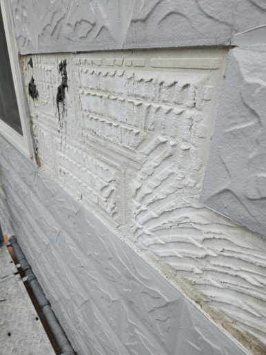
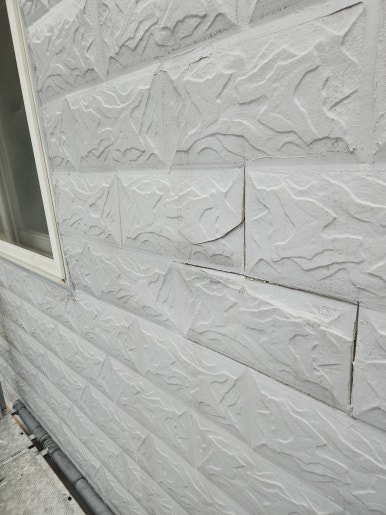
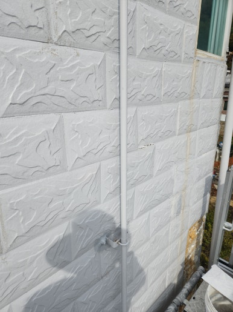
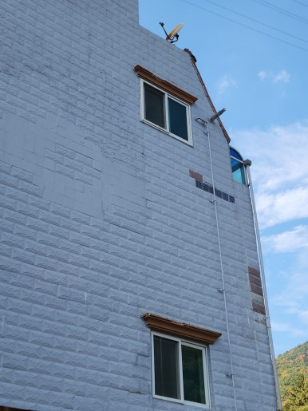

주택, 아파트, 공장, 상가 등 각종 시설물 보수부터 지붕 방수, 외벽 보수, 누수 공사까지 현장 상태에 맞춰 문제를 확실하게 해결해 드리는 집수리남입니다.

오늘은 대구 남구 건물 들뜬 외벽 타일 보수 작업 현장을 소개해 드리겠습니다.  외벽에 시공된 타일 일부가 벽면에서 들떠 접착력이 약해진 부분을 정리하고 튼튼하게 재부착한 현장입니다.

들뜬 외벽 타일을 방치하면 시간이 지나면서 타일이 탈락해 보행자 안전사고나 주변 타일 연쇄 손상으로 이어질 수 있습니다. 들뜬 상태와 주변 접착 상태를 면밀히 점검한 후 손상 부위를 중심으로 깔끔하게 복구했습니다.

<h2>이런 경우 외벽 타일 보수 작업이 필요합니다</h2>

- 건물 외벽 타일이 벽면에서 들뜨는 경우
 
- 타일을 두드렸을 때 속이 빈 소리가 나는 경우
 
- 외벽 타일 일부가 떨어지거나 탈락된 경우
 
- 타일 사이 줄눈이 갈라지거나 손상된 경우
 
- 오래된 건물로 외벽 타일 접착력이 걱정되는 경우

<h2>외벽 타일 보수 작업 과정</h2>

1. 현장 점검 (외벽 타일 들뜸 및 손상 상태 확인)
 
2. 불량 부위 정리 (들뜬 타일과 불량 접착 부분 제거)
 
3. 바탕면 정리 (기존 접착 잔여물 및 이물질 제거)
 
4. 타일 재부착 (전용 접착제를 사용하여 타일 보수)
 
5. 마무리 점검 (줄눈 및 주변 타일 마감 상태 확인)

이번 작업은 약 7~8시간 내외 소요되어
당일 작업을 차질 없이 완료하였습니다.

<h2>작업 후 개선 효과</h2>

✔ 들뜬 외벽 타일 보수 및 접착 상태 개선 
✔ 불량 접착 부위 정리 및 타일 재부착 
✔ 타일 주변 마감 및 줄눈 상태 정비 
✔ 외벽 타일 추가 탈락 위험 예방에 도움 
✔ 건물 외관 개선 및 유지관리 효과

<h2>이런 경우 꼭 필요합니다!</h2>

✔ 건물 외벽 타일이 앞으로 튀어나온 경우 
✔ 타일을 두드렸을 때 속이 빈 소리가 나는 경우 
✔ 외벽 타일 일부가 떨어져 나간 경우 
✔ 타일 사이 줄눈이 갈라지거나 떨어진 경우 
✔ 오래된 건물의 외벽 타일 상태가 걱정되는 경우

<h3 style="margin:0 0 12px 0;">
📌 더 자세한 시공 사례
</h3>

시공 과정과 작업 전후 사진은
네이버 블로그에서
더 자세하게 확인하실 수 있습니다.

<a href="https://blog.naver.com/house_surri/224476237404"
target="_blank"
rel="noopener"
style="
display:inline-block;
background:#03C75A;
color:#fff;
text-decoration:none;
padding:12px 22px;
border-radius:8px;
font-weight:700;">
네이버 블로그에서 자세히 보기 →
</a>

<h2>시공 문의 안내</h2>

건물 외벽 들뜬 타일 보수 / 외벽 타일 탈락 및 파손 부위 복구 / 외벽 타일 접착 및 줄눈 보수 / 노후 건물 외벽 타일 점검 및 정비

전화 • 문자 • 카톡

편하게 문의 주세요!

