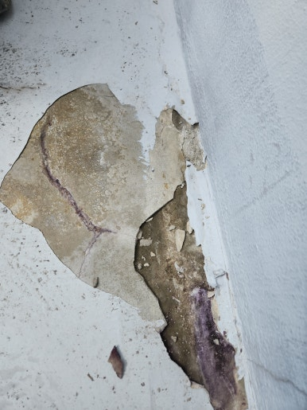
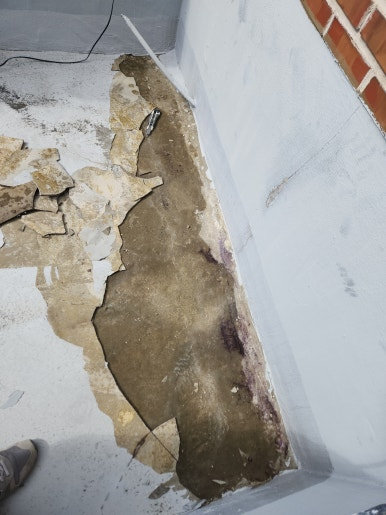
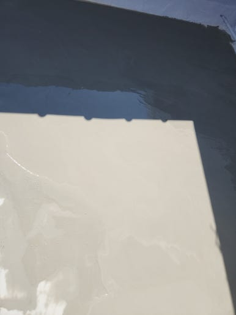
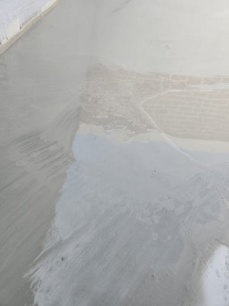

주택, 아파트, 공장, 상가 등 각종 시설물 보수부터 옥상 방수, 외벽 보수, 누수 공사까지 현장 상태에 맞춰 문제를 확실하게 해결해 드리는 집수리남입니다.

오늘은 대구 서구 건물 옥상 방수 및 수평 몰탈 작업 현장을 소개해 드리겠습니다.  노후화되고 불균형해진 옥상 바닥의 기존 바닥 상태를 꼼꼼히 확인한 후, 바탕면 정리부터 수평 몰탈 시공까지 순차적으로 진행한 현장입니다.

외부 환경에 지속적으로 노출된 옥상은 시간이 지나면서 바닥이 갈라지거나 물이 고이는 문제가 발생할 수 있습니다. 방수재를 시공하기 전 바탕면을 얼마나 꼼꼼하게 정리하느냐에 따라 시공 품질과 유지관리에 차이가 생길 수 있어, 높낮이와 균열을 면밀히 점검한 후 바닥 면을 깔끔하게 정비했습니다.

<h2>이런 경우 옥상 수평 몰탈 작업이 필요합니다</h2>

- 옥상 바닥이 울퉁불퉁하고 고르지 않은 경우
 
- 바닥에 물이 고이는 구간이 발생하는 경우
 
- 기존 몰탈층이 노후되거나 손상된 경우
 
- 옥상 방수 시공 전 바닥 정비가 필요한 경우
 
- 바닥 균열 및 표면 불량으로 보수가 필요한 경우

<h2>옥상 수평 몰탈 작업 과정</h2>

1. 현장 점검 (옥상 바닥 상태 및 높낮이 확인)
 
2. 바닥 정리 (이물질 및 들뜬 기존 몰탈 제거)
 
3. 바탕면 처리 (먼지 제거 및 접착력 확보를 위한 바탕 작업)
 
4. 수평 몰탈 시공 (바닥 높낮이에 맞춰 몰탈 타설 및 면 정리)
 
5. 마무리 점검 (바닥 수평 및 배수 구배 확인)

이번 작업은 약 5시간 내외 소요되어
당일 작업을 차질 없이 완료하였습니다.

<h2>작업 후 개선 효과</h2>

✔ 울퉁불퉁한 옥상 바닥면 정리 
✔ 바닥 높낮이 및 표면 상태 개선 
✔ 수평 몰탈 시공으로 바닥면 평탄성 확보 
✔ 후속 방수 시공을 위한 바탕면 조성 
✔ 옥상 바닥 유지관리 및 사용 환경 개선

<h2>이런 경우 꼭 필요합니다!</h2>

✔ 옥상 바닥이 울퉁불퉁하고 평탄하지 않은 경우 
✔ 비가 온 뒤 옥상에 물이 오래 고이는 경우 
✔ 기존 몰탈 바닥이 갈라지거나 깨진 경우 
✔ 옥상 방수 시공 전 바닥 정리가 필요한 경우 
✔ 노후된 옥상 바닥을 새롭게 정비하고 싶은 경우

<h3 style="margin:0 0 12px 0;">
📌 더 자세한 시공 사례
</h3>

시공 과정과 작업 전후 사진은
네이버 블로그에서
더 자세하게 확인하실 수 있습니다.

<a href="https://blog.naver.com/house_surri/224476954043"
target="_blank"
rel="noopener"
style="
display:inline-block;
background:#03C75A;
color:#fff;
text-decoration:none;
padding:12px 22px;
border-radius:8px;
font-weight:700;">
네이버 블로그에서 자세히 보기 →
</a>

<h2>시공 문의 안내</h2>

옥상 방수 및 수평 몰탈 시공 / 옥상 바닥 균열 및 노후 몰탈 보수 / 옥상 바닥 평탄화 및 바탕면 정비

전화 • 문자 • 카톡

편하게 문의 주세요!

