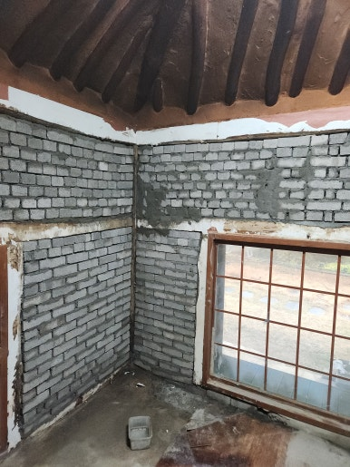
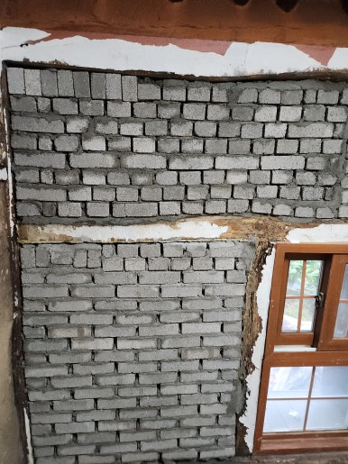
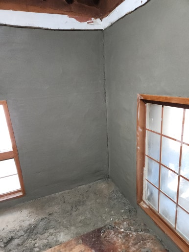
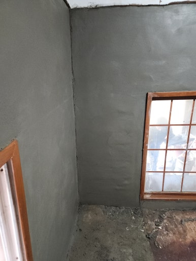

주택, 아파트, 공장, 상가 등 각종 시설물 보수부터 내벽 미장, 바닥 미장, 균열 보수까지 현장 상태에 맞춰 문제를 확실하게 해결해 드리는 집수리남입니다.

오늘은 대구 서구 주택 벽돌 벽체 시멘트 미장작업 현장을 소개해 드리겠습니다.  기존 흙 벽체를 철거하고 새롭게 시공한 벽돌 벽체의 틈새와 고르지 않은 표면을 정리한 후 시멘트 모르타르로 벽면을 평탄하게 마감한 현장입니다.

시멘트 미장 작업은 단순히 벽면에 모르타르를 바르는 것이 아니라 벽돌의 흡수 상태와 표면의 높낮이를 확인하고 적절한 두께로 고르게 시공하는 것이 중요합니다. 바탕면에 먼지나 이물질이 남아 있으면 모르타르의 접착력이 떨어질 수 있어, 작업 전 바탕면을 꼼꼼하게 정리한 뒤 시공을 진행했습니다.

<h2>이런 경우 벽돌 벽체 시멘트 미장작업이 필요합니다</h2>

- 새롭게 시공된 벽돌 벽체의 표면이 거친 경우
 
- 벽돌 사이사이 줄눈과 틈새 정리가 필요한 경우
 
- 벽면 높낮이가 일정하지 않은 경우
 
- 도배 및 페인트 시공 전 바탕면 정리가 필요한 경우
 
- 벽돌 벽체를 깔끔한 미장면으로 마감하고 싶은 경우

<h2>벽돌 벽체 시멘트 미장 작업 과정</h2>

1. 현장 점검 (벽돌 벽체 상태 및 표면 확인)
 
2. 바탕면 정리 (벽면 먼지 및 이물질 제거)
 
3. 바탕면 처리 (벽체 흡수 상태 확인 및 바탕 작업)
 
4. 시멘트 미장 (모르타르 도포 및 벽면 평탄화)
 
5. 마무리 점검 (벽면 표면 및 미장 상태 확인)

이번 작업은 약 4~5시간 내외 소요되어
당일 작업을 완료하였습니다.

<h2>작업 후 개선 효과</h2>

✔ 노출된 벽돌 표면을 시멘트 미장으로 정리 
✔ 벽돌 사이 줄눈 및 틈새 마감 
✔ 울퉁불퉁한 벽면 평탄성 개선 
✔ 도배 및 페인트 등 후속 마감 작업을 위한 바탕면 확보 
✔ 주택 내부 벽면의 깔끔한 마감 효과

<h2>이런 경우 꼭 필요합니다!</h2>

✔ 새롭게 시공한 벽돌 벽체의 미장이 필요한 경우 
✔ 벽돌이 그대로 노출되어 표면 정리가 필요한 경우 
✔ 벽돌 사이 줄눈과 틈새 마감이 필요한 경우 
✔ 벽면이 고르지 않아 평탄화가 필요한 경우 
✔ 도배나 페인트 작업 전 미장 시공이 필요한 경우

<h3 style="margin:0 0 12px 0;">
📌 더 자세한 시공 사례
</h3>

시공 과정과 작업 전후 사진은
네이버 블로그에서
더 자세하게 확인하실 수 있습니다.

<a href="https://blog.naver.com/house_surri/224478382218"
target="_blank"
rel="noopener"
style="
display:inline-block;
background:#03C75A;
color:#fff;
text-decoration:none;
padding:12px 22px;
border-radius:8px;
font-weight:700;">
네이버 블로그에서 자세히 보기 →
</a>

<h2>시공 문의 안내</h2>

주택 내부 벽돌 벽체 시멘트 미장 / 벽면 평탄화 및 미장 보수 / 벽돌 줄눈 및 틈새 마감 / 내벽 균열 및 손상 부위 보수

전화 • 문자 • 카톡

편하게 문의 주세요!

