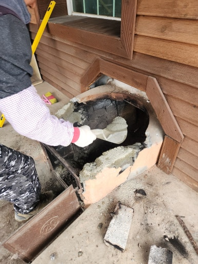
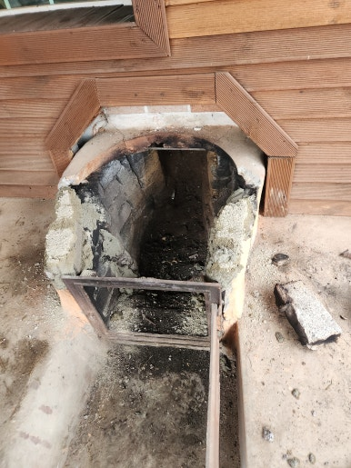
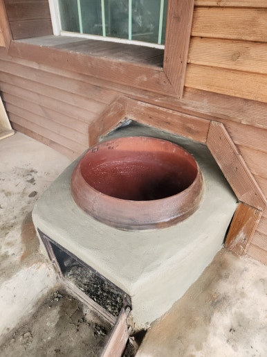
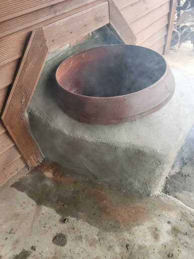

주택, 아파트, 공장, 상가 등 각종 시설물 보수부터 내벽 미장, 바닥 미장, 균열 보수까지 현장 상태에 맞춰 문제를 확실하게 해결해 드리는 집수리남입니다.

오늘은 대구 군위군 시골집 아궁이 보수 작업 현장을 소개해 드리겠습니다.  세월의 흔적으로 균열이 가고 기존 미장이 떨어진 노후 아궁이의 내외부 손상 부위를 정리한 뒤, 현장 상태에 맞춰 보수 및 미장 작업을 진행한 현장입니다.

아궁이는 불을 직접 사용하는 공간인 만큼 일반적인 벽면 보수와는 다르게 접근해야 합니다. 균열과 탈락 부위를 꼼꼼하게 확인하고 기존 약한 부분을 제거한 뒤, 열을 견딜 수 있는 적합한 내열 재료를 사용하여 기초부터 튼튼하게 시공하는 것이 중요합니다.

<h2>이런 경우 아궁이 보수 작업이 필요합니다</h2>

- 오랜 사용으로 아궁이 벽체에 금이 간 경우
 
- 기존 미장면이 노후되어 떨어져 나간 경우
 
- 아궁이 주변 벽체가 갈라지고 손상된 경우
 
- 시골집 아궁이를 다시 깔끔하게 정비하고 싶은 경우
 
- 노후된 아궁이의 파손 부위를 안전하게 보수해야 하는 경우

<h2>아궁이 보수 작업 과정</h2>

1. 현장 점검 (아궁이 노후 상태 및 균열 부위 확인)
 
2. 손상 부위 정리 (떨어져 나간 미장면과 약한 부분 제거)
 
3. 바탕면 정리 (먼지 및 이물질 제거 후 보수면 준비)
 
4. 아궁이 보수 작업 (적합한 내열 재료를 사용해 균열 및 파손 부위 보수)
 
5. 마감 및 점검 (보수 부위 정리 및 마감 상태 확인)

이번 작업은 약 6시간 내외 소요되어
당일 작업을 완료하였습니다.

<h2>작업 후 개선 효과</h2>

✔ 노후되어 갈라진 아궁이 손상 부위 보수 
✔ 떨어져 나간 미장 부분 정리 및 복원 
✔ 손상된 벽체 표면 정돈 
✔ 아궁이 주변 마감 상태 개선 
✔ 시골집 아궁이의 외관 및 사용 환경 정비

<h2>이런 경우 꼭 필요합니다!</h2>

✔ 오래된 시골집 아궁이가 갈라진 경우 
✔ 아궁이 주변 미장면이 떨어져 나간 경우 
✔ 벽체에 균열이 생겨 보수가 필요한 경우 
✔ 노후된 아궁이를 깔끔하게 정비하고 싶은 경우 
✔ 아궁이 주변 파손 및 손상 부위가 발생한 경우

<h3 style="margin:0 0 12px 0;">
📌 더 자세한 시공 사례
</h3>

시공 과정과 작업 전후 사진은
네이버 블로그에서
더 자세하게 확인하실 수 있습니다.

<a href="https://blog.naver.com/house_surri/224480872590"
target="_blank"
rel="noopener"
style="
display:inline-block;
background:#03C75A;
color:#fff;
text-decoration:none;
padding:12px 22px;
border-radius:8px;
font-weight:700;">
네이버 블로그에서 자세히 보기 →
</a>

<h2>시공 문의 안내</h2>

시골집 아궁이 보수 및 미장 작업 / 노후 아궁이 균열 및 파손 보수 / 주택 내외부 각종 시설물 보수

전화 • 문자 • 카톡

편하게 문의 주세요!

