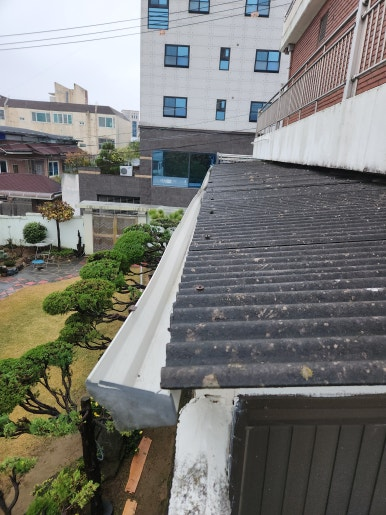
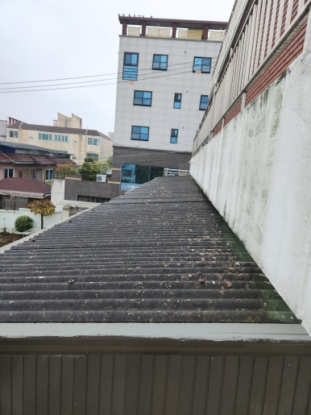
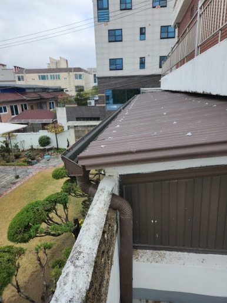
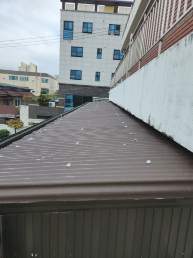

주택, 아파트, 공장, 상가 등 각종 시설물 보수부터 지붕 방수, 외벽 보수, 누수 공사까지 현장 상태에 맞춰 문제를 확실하게 해결해 드리는 집수리남입니다.

오늘은 대구 수성구 주택 노후 지붕 칼라강판 덧씌우기 작업 현장을 소개해 드리겠습니다.  오랜 시간 사용하면서 노후화된 기존 지붕을 철거하는 대신, 현장 상태를 꼼꼼하게 확인한 후 기존 지붕 위에 칼라강판을 덧씌우는 방식으로 보수 및 시공을 진행한 현장입니다.

지붕은 비바람과 햇빛 등 외부 환경에 직접적으로 노출되는 부분인 만큼 평소 꼼꼼한 관리와 점검이 중요합니다. 노후된 지붕은 손상 부위와 누수 여부를 먼저 확인한 뒤 현장 구조에 적합한 시공 방법을 선택해야 하며, 빗물이 유입되지 않도록 겹침 부위와 연결 부분을 꼼꼼하게 시공하는 것이 핵심입니다.

<h2>이런 이유로 작업을 진행했습니다</h2>

- 오래된 주택 지붕이 노후되어 보수가 필요한 경우
 
- 기존 지붕의 방수 및 마감 상태가 불량한 경우
 
- 비가 올 때 지붕 누수가 걱정되는 경우
 
- 지붕 표면이 낡고 변색되어 외관 개선이 필요한 경우
 
- 기존 지붕 철거 부담을 줄이고 새롭게 정비하고 싶은 경우

<h2>칼라강판 덧씌우기 작업 과정</h2>

1. 현장 점검 (기존 지붕 노후 상태 및 손상 부위 확인)
 
2. 지붕 바탕 정리 (이물질 제거 및 시공면 정돈)
 
3. 하지 및 고정 작업 (지붕 구조에 맞춰 하지 상태 확인 및 보강)
 
4. 칼라강판 설치 (기존 지붕 위 칼라강판 덧씌우기 시공)
 
5. 마감 및 점검 (이음새와 고정 상태 확인 후 마무리)

이번 작업은 약 5~6시간 내외 소요되어
당일 작업을 완료하였습니다.

<h2>작업 후 개선 효과</h2>

✔ 노후된 기존 지붕의 외관 개선 
✔ 칼라강판 시공으로 지붕 마감 상태 정비 
✔ 기존 지붕 철거 없이 덧씌우기 방식으로 시공 
✔ 지붕 이음새 및 연결 부위 마감 개선 
✔ 주택 지붕의 유지관리 및 내구성 향상에 도움

<h2>이런 경우 꼭 필요합니다!</h2>

✔ 오래된 주택 지붕이 낡고 변색된 경우 
✔ 지붕 마감재가 노후되어 교체가 필요한 경우 
✔ 기존 지붕을 철거하지 않고 새롭게 정비하고 싶은 경우 
✔ 빗물 유입 및 지붕 누수가 걱정되는 경우 
✔ 주택 지붕의 외관을 깔끔하게 개선하고 싶은 경우

<h3 style="margin:0 0 12px 0;">
📌 더 자세한 시공 사례
</h3>

시공 과정과 작업 전후 사진은
네이버 블로그에서
더 자세하게 확인하실 수 있습니다.

<a href="https://blog.naver.com/house_surri/224482483256"
target="_blank"
rel="noopener"
style="
display:inline-block;
background:#03C75A;
color:#fff;
text-decoration:none;
padding:12px 22px;
border-radius:8px;
font-weight:700;">
네이버 블로그에서 자세히 보기 →
</a>

<h2>시공 문의 안내</h2>

노후 지붕 칼라강판 덧씌우기 및 교체 시공 / 지붕 누수·파손 보수 및 각종 시설물 수리 / 주택 내·외부 전반적인 보수 및 시공

전화 • 문자 • 카톡

편하게 문의 주세요!

