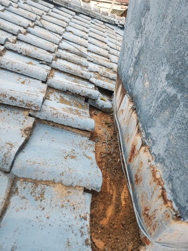
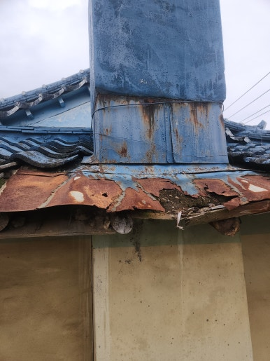
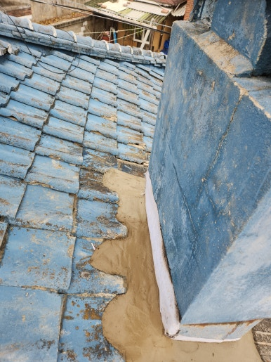
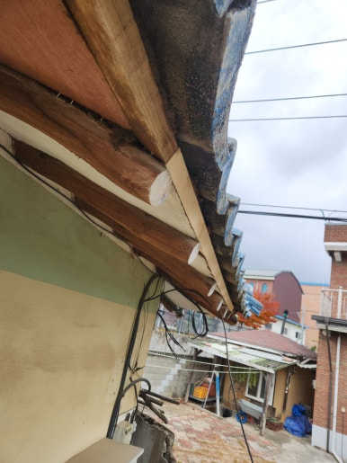

주택, 아파트, 공장, 상가 등 각종 시설물 보수부터 지붕 방수, 외벽 보수, 누수 공사까지 현장 상태에 맞춰 문제를 확실하게 해결해 드리는 집수리남입니다.

오늘은 대구 군위군 주택 노후 기와지붕 및 굴뚝 누수 방수 작업 현장을 소개해 드리겠습니다.  오랜 시간 외부 환경에 노출되어 지붕 서까래가 노후되고 굴뚝 주변으로 누수가 발생하여, 현장 상태를 꼼꼼하게 점검한 후 방수 및 보수 작업을 진행한 현장입니다.

기와지붕은 지붕을 받쳐주는 서까래의 상태는 물론 굴뚝과 지붕이 연결되는 부분의 방수 상태가 매우 중요합니다. 서까래가 부식되거나 약해지면 지붕 안정성에 영향을 줄 수 있고, 굴뚝 연결 부위에 틈이 생기면 빗물이 쉽게 유입되므로 원인을 정확히 파악해 꼼꼼하게 보수하는 것이 핵심입니다.

<h2>이런 이유로 작업을 진행했습니다</h2>

- 오랜 세월 사용으로 지붕 서까래가 낡고 노후된 경우
 
- 굴뚝과 지붕이 만나는 부분에서 누수가 발생하는 경우
 
- 비가 오면 굴뚝 주변으로 빗물이 스며드는 경우
 
- 오래된 기와지붕의 연결 부위 방수 보수가 필요한 경우
 
- 노후된 지붕 구조물과 누수 부위를 함께 정비하고 싶은 경우

<h2>기와지붕 및 굴뚝 방수 작업 과정</h2>

1. 현장 점검 (노후된 서까래 및 굴뚝 주변 누수 부위 확인)
 
2. 손상 부위 정리 (노후된 부분과 기존 불량 마감재 정리)
 
3. 바탕면 정리 (굴뚝 주변 이물질 제거 및 보수면 정돈)
 
4. 방수 및 보수 작업 (굴뚝 연결 부위 방수 처리 및 서까래 보수)
 
5. 마감 및 점검 (방수 마감 상태와 지붕 주변 상태 확인)

이번 작업은 약 6시간 내외 소요되어
당일 작업을 완료하였습니다.

<h2>작업 후 개선 효과</h2>

✔ 노후된 지붕 서까래 상태 점검 및 필요한 부분 보수 
✔ 굴뚝 주변 누수 발생 부위 방수 작업 
✔ 지붕과 굴뚝 연결 부위 틈새 정비 
✔ 빗물 유입 방지를 위한 방수 마감 개선 
✔ 오래된 기와지붕의 유지관리 환경 개선

<h2>이런 경우 꼭 필요합니다!</h2>

✔ 오래된 주택 지붕 서까래가 낡고 부식된 경우 
✔ 굴뚝 주변에서 비가 새는 경우 
✔ 굴뚝과 기와지붕 연결 부분에 틈이 발생한 경우 
✔ 지붕 내부 목재가 습기에 노출되어 손상된 경우 
✔ 노후된 기와지붕과 굴뚝 주변 방수 보수가 필요한 경우

<h3 style="margin:0 0 12px 0;">
📌 더 자세한 시공 사례
</h3>

시공 과정과 작업 전후 사진은
네이버 블로그에서
더 자세하게 확인하실 수 있습니다.

<a href="https://blog.naver.com/house_surri/224482618220"
target="_blank"
rel="noopener"
style="
display:inline-block;
background:#03C75A;
color:#fff;
text-decoration:none;
padding:12px 22px;
border-radius:8px;
font-weight:700;">
네이버 블로그에서 자세히 보기 →
</a>

<h2>시공 문의 안내</h2>

노후 기와지붕 및 서까래 보수 / 굴뚝 주변 누수·방수 공사 / 지붕 파손 보수 및 주택 내·외부 수리 시공

전화 • 문자 • 카톡

편하게 문의 주세요!

