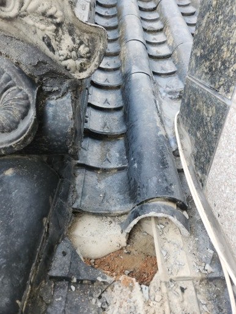
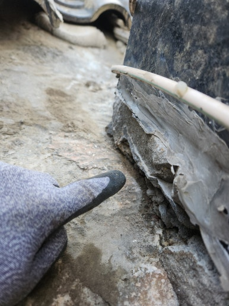
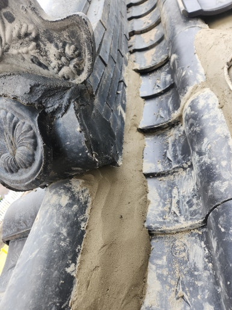
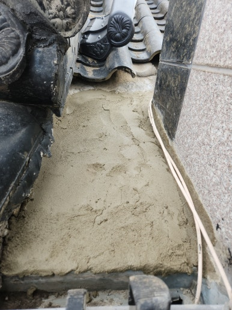

주택, 아파트, 공장, 상가 등 각종 시설물 보수부터 지붕 방수, 외벽 보수, 누수 공사까지 현장 상태에 맞춰 문제를 확실하게 해결해 드리는 집수리남입니다.

오늘은 대구 동구 주택 깨진 기와 교체 및 방수 미장 작업 현장을 소개해 드리겠습니다.  장기간 외부 환경에 노출되어 지붕 기와 일부가 깨지고 노후된 미장 마감 부위에 균열과 틈이 발생해, 누수 및 지붕 내부 목재 손상을 예방하고자 보수 작업을 진행한 현장입니다.

지붕은 외부로부터 주택을 보호하는 중요한 부분으로, 작은 기와 파손이나 미장 틈새라도 시간이 지나면 빗물 유입 및 목재 부식으로 이어질 수 있습니다. 따라서 파손 부위를 정확하게 확인하고 주변 마감 상태까지 함께 점검하여 보수하는 것이 핵심입니다.

<h2>이런 이유로 작업을 진행했습니다</h2>

- 오래된 주택 기와가 깨지거나 파손된 경우
 
- 비가 올 때 지붕으로 빗물이 유입될 우려가 있는 경우
 
- 기와 주변 미장 마감이 갈라지거나 떨어진 경우
 
- 지붕 연결 부위에 틈이 발생한 경우
 
- 깨진 기와 교체와 방수 보수를 함께 진행하고 싶은 경우

<h2>깨진 기와 교체 및 방수 미장 작업 과정</h2>

1. 현장 점검 (깨진 기와와 주변 손상 부위 확인)
 
2. 파손 기와 철거 (깨진 기와 제거 및 작업 부위 정리)
 
3. 바탕면 정리 (기와 주변 이물질 제거 및 미장 바탕 정돈)
 
4. 기와 교체 및 방수 미장 (새 기와 설치 및 주변 방수 미장 작업)
 
5. 마감 및 점검 (기와 고정 상태와 미장 마감 상태 확인)

이번 작업은 약 6시간 내외 소요되어
당일 작업을 완료하였습니다.

<h2>작업 후 개선 효과</h2>

✔ 파손된 기와 교체로 지붕 손상 부위 정비 
✔ 기와 주변 미장 마감 보수 
✔ 지붕 연결 부위 틈새 정리 
✔ 빗물 유입 방지를 위한 방수 마감 개선 
✔ 노후 주택 지붕 유지관리 환경 개선

<h2>이런 경우 꼭 필요합니다!</h2>

✔ 주택 지붕 기와가 깨지거나 금이 간 경우 
✔ 비가 오면 지붕 주변으로 물이 스며드는 경우 
✔ 오래된 기와 주변 미장 부분이 떨어지는 경우 
✔ 기와 사이에 틈이 발생하여 보수가 필요한 경우 
✔ 지붕 기와 교체와 방수 미장 작업을 함께 원하는 경우

<h3 style="margin:0 0 12px 0;">
📌 더 자세한 시공 사례
</h3>

시공 과정과 작업 전후 사진은
네이버 블로그에서
더 자세하게 확인하실 수 있습니다.

<a href="https://blog.naver.com/house_surri/224485239626"
target="_blank"
rel="noopener"
style="
display:inline-block;
background:#03C75A;
color:#fff;
text-decoration:none;
padding:12px 22px;
border-radius:8px;
font-weight:700;">
네이버 블로그에서 자세히 보기 →
</a>

<h2>시공 문의 안내</h2>

깨진 기와 교체 및 지붕 보수 / 주택 지붕 방수 및 방수 미장 작업 / 노후 주택 누수 점검 및 각종 시설물 보수

전화 • 문자 • 카톡

편하게 문의 주세요!

