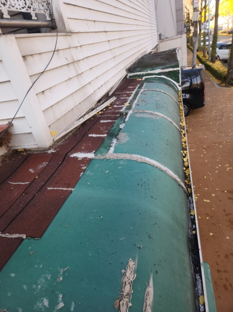
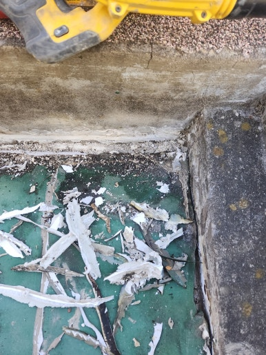
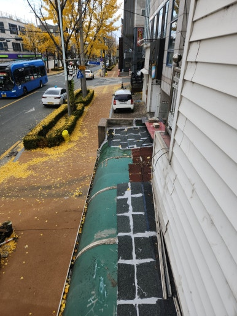
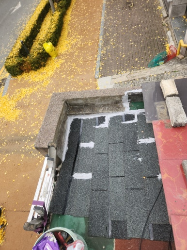

주택, 아파트, 공장, 상가 등 각종 시설물 보수부터 지붕 방수, 외벽 보수, 누수 공사까지 현장 상태에 맞춰 문제를 확실하게 해결해 드리는 집수리남입니다.

오늘은 대구 남구 렉산 지붕 누수 보수 및 코킹 작업 현장을 소개해 드리겠습니다.  기존 렉산 지붕의 노후된 실리콘과 코킹 마감 부위에서 누수 가능성이 확인되어, 렉산 판재와 프레임 연결 부위를 점검하고 기존 코킹을 정리한 후 재시공하여 빗물 유입을 방지한 현장입니다.

렉산 지붕은 판재 자체의 상태도 중요하지만, 연결 부위와 가장자리의 코킹 상태가 누수 예방에 큰 영향을 미칩니다. 누수 보수 작업은 물이 떨어지는 위치만 막는 것이 아니라 실제 빗물이 유입되는 원인을 찾아 처리하는 것이 핵심입니다.

<h2>이런 이유로 작업을 진행했습니다</h2>

- 렉산 지붕 연결 부위에서 빗물이 새는 경우
 
- 기존 실리콘이 갈라지거나 들뜬 경우
 
- 렉산과 프레임 사이에 틈이 발생한 경우
 
- 비가 올 때 지붕 아래로 물이 떨어지는 경우
 
- 오래된 렉산 지붕의 방수 마감 보수가 필요한 경우

<h2>렉산 지붕 누수 보수 및 코킹 작업 과정</h2>

1. 현장 점검 (렉산 지붕 및 누수 의심 부위 확인)
 
2. 기존 코킹 제거 (노후되고 들뜬 기존 실리콘 정리)
 
3. 바탕면 정리 (이물질과 먼지 제거 및 시공면 정돈)
 
4. 코킹 및 방수 작업 (렉산 연결 부위 꼼꼼하게 코킹 시공)
 
5. 마감 및 점검 (코킹 마감 상태와 주변 누수 여부 확인)

이번 작업은 약 5~6시간 내외 소요되어
당일 작업을 완료하였습니다.

<h2>작업 후 개선 효과</h2>

✔ 렉산 지붕 연결 부위 노후 코킹 정비 
✔ 기존 불량 실리콘 제거 및 새로운 코킹 시공 
✔ 렉산과 프레임 사이 틈새 보수 
✔ 빗물 유입 방지를 위한 방수 마감 개선 
✔ 지붕 누수 예방 및 유지관리 환경 개선

<h2>이런 경우 꼭 필요합니다!</h2>

✔ 렉산 지붕에서 비가 새는 경우 
✔ 렉산 연결 부위 실리콘이 갈라진 경우 
✔ 지붕 프레임 주변으로 빗물이 스며드는 경우 
✔ 기존 코킹이 들뜨거나 떨어져 나간 경우 
✔ 오래된 렉산 지붕 방수 보수가 필요한 경우

<h3 style="margin:0 0 12px 0;">
📌 더 자세한 시공 사례
</h3>

시공 과정과 작업 전후 사진은
네이버 블로그에서
더 자세하게 확인하실 수 있습니다.

<a href="https://blog.naver.com/house_surri/224485361994"
target="_blank"
rel="noopener"
style="
display:inline-block;
background:#03C75A;
color:#fff;
text-decoration:none;
padding:12px 22px;
border-radius:8px;
font-weight:700;">
네이버 블로그에서 자세히 보기 →
</a>

<h2>시공 문의 안내</h2>

렉산 지붕 누수 보수 및 코킹 작업 / 렉산 지붕 실리콘 재시공 및 방수 작업 / 주택 및 상가 지붕 보수

전화 • 문자 • 카톡

편하게 문의 주세요!

