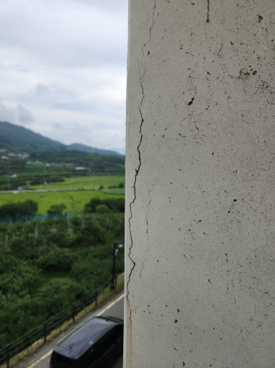
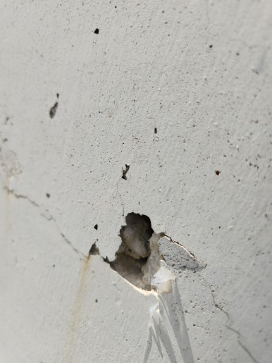
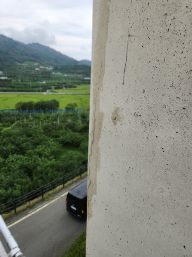
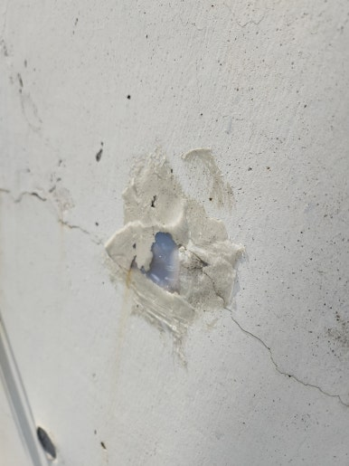

주택, 아파트, 공장, 상가 등 각종 시설물 보수부터 지붕 방수, 외벽 보수, 누수 공사까지 현장 상태에 맞춰 문제를 확실하게 해결해 드리는 집수리남입니다.

오늘은 대구 달성군 건물 외벽 누수 보수 작업 현장을 소개해 드리겠습니다.  기존 건물 외벽의 노후화와 마감 손상으로 빗물 유입이 우려되어, 외벽의 균열과 창틀 주변, 연결 부위의 틈새를 꼼꼼히 점검한 후 누수 위험 부위를 중심으로 보수 및 방수 마감한 현장입니다.

건물 외벽 누수는 단순히 물이 스며드는 문제뿐만 아니라 내부 벽체와 마감재까지 손상시킬 수 있습니다. 외벽 누수는 발생 위치와 실제 빗물 유입 위치가 다를 수 있기 때문에 정확한 현장 점검을 통해 원인을 찾아 적절하게 보수하는 것이 핵심입니다.

<h2>이런 이유로 작업을 진행했습니다</h2>

- 비가 오면 건물 내부 벽면에 물기가 생기는 경우
 
- 외벽 페인트가 부풀거나 벗겨지는 경우
 
- 벽면에 균열이나 틈새가 발생한 경우
 
- 창틀 및 외벽 연결 부위에서 누수가 발생하는 경우
 
- 기존 실리콘과 방수 마감재가 노후된 경우

<h2>건물 외벽 누수 보수 작업 과정</h2>

1. 현장 점검 (외벽 상태 및 누수 의심 부위 확인)
 
2. 기존 마감 정리 (노후 실리콘과 불량 마감재 제거)
 
3. 바탕면 정리 (이물질 및 먼지 제거 후 시공면 정돈)
 
4. 외벽 보수 및 방수 작업 (균열과 틈새 보수 및 방수 마감 시공)
 
5. 마감 및 점검 (시공 부위 마감 상태와 주변 이상 여부 확인)

이번 작업은 약 5~6시간 내외 소요되어
당일 작업을 완료하였습니다.

<h2>작업 후 개선 효과</h2>

✔ 외벽 노후 및 불량 마감 부위 정비 
✔ 균열과 틈새 보수로 빗물 유입 경로 차단 
✔ 외벽 연결 부위 방수 마감 개선 
✔ 기존 손상 부위 보수로 외벽 유지관리 개선 
✔ 건물 내부 누수 및 추가 손상 예방에 도움

<h2>이런 경우 꼭 점검받으세요!</h2>

✔ 비가 오면 실내 벽면에 물이 맺히는 경우 
✔ 건물 외벽에 가로 또는 세로 균열이 생긴 경우 
✔ 외벽 페인트가 부풀거나 떨어지는 경우 
✔ 창틀 주변으로 빗물이 스며드는 경우 
✔ 오래된 건물의 외벽 방수 보수가 필요한 경우

<h3 style="margin:0 0 12px 0;">
📌 더 자세한 시공 사례
</h3>

시공 과정과 작업 전후 사진은
네이버 블로그에서
더 자세하게 확인하실 수 있습니다.

<a href="https://blog.naver.com/house_surri/224486872855"
target="_blank"
rel="noopener"
style="
display:inline-block;
background:#03C75A;
color:#fff;
text-decoration:none;
padding:12px 22px;
border-radius:8px;
font-weight:700;">
네이버 블로그에서 자세히 보기 →
</a>

<h2>시공 문의 안내</h2>

외벽 누수 및 균열 보수 / 실리콘•코킹 재시공 / 건물 외벽 방수 작업

전화 • 문자 • 카톡

편하게 문의 주세요!

