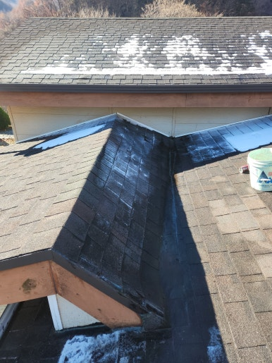
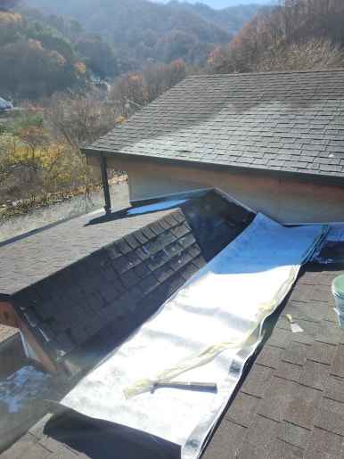
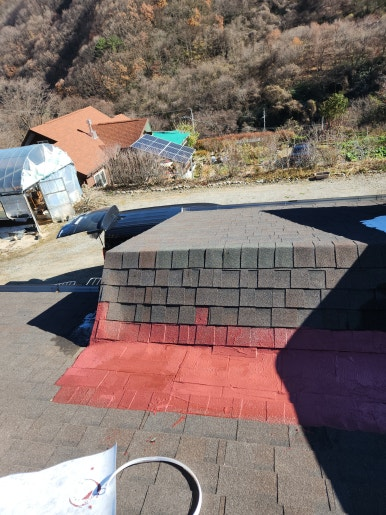
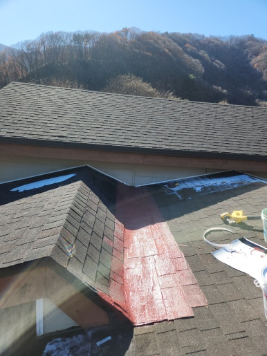

주택, 아파트, 공장, 상가 등 각종 시설물 보수부터 지붕 방수, 외벽 보수, 누수 공사까지 현장 상태에 맞춰 문제를 확실하게 해결해 드리는 집수리남입니다.

오늘은 대구 군위군 전원주택 아스팔트 슁글 지붕 수리 및 물골 누수 방수 작업 현장을 소개해 드리겠습니다.  노후화된 아스팔트 슁글 지붕과 지붕 물골 주변의 방수 기능 저하로 누수가 우려되어, 취약 부위를 중심으로 지붕 보수 및 방수 작업을 진행한 현장입니다.

특히 지붕 물골은 비가 내리면 빗물이 집중적으로 흘러내리는 부분이기 때문에 방수 마감이 손상되거나 틈새가 발생하면 누수로 이어질 가능성이 높습니다. 작은 틈새라도 방치하면 지붕 내부 목재와 천장 마감재까지 손상시킬 수 있으므로 초기 점검과 적절한 보수가 핵심입니다.

<h2>이런 이유로 작업을 진행했습니다</h2>

- 비가 많이 내리면 천장이나 벽면에 누수 흔적이 생기는 경우
 
- 아스팔트 슁글이 들뜨거나 파손된 경우
 
- 기존 방수재와 실리콘 마감이 노후된 경우
 
- 지붕 물골 주변으로 빗물이 스며드는 경우
 
- 지붕 연결 부위에 틈새와 균열이 발생한 경우

<h2>슁글 지붕 수리 및 물골 방수 작업 과정</h2>

1. 현장 점검 (지붕 슁글 및 물골 누수 의심 부위 확인)
 
2. 기존 마감 정리 (노후 방수재와 불량 마감 부위 제거)
 
3. 바탕면 정리 (이물질 제거 및 시공면 청소)
 
4. 지붕 보수 및 방수 작업 (슁글 손상 부위 보수 및 물골 방수 시공)
 
5. 마감 및 점검 (방수 마감 상태와 빗물 배수 상태 확인)

이번 작업은 약 5~6시간 내외 소요되어
당일 작업을 완료하였습니다.

<h2>작업 후 개선 효과</h2>

✔ 노후된 아스팔트 슁글 손상 부위 정비 
✔ 지붕 물골 주변 누수 취약 부위 방수 보강 
✔ 빗물 유입 가능성이 있는 틈새 보수 
✔ 지붕 연결 부위 방수 마감 개선 
✔ 지붕 유지관리 및 추가 누수 피해 예방에 도움

<h2>이런 경우 꼭 필요합니다!</h2>

✔ 비가 오면 천장에서 물이 떨어지는 경우 
✔ 아스팔트 슁글이 들뜨거나 깨진 경우 
✔ 지붕 물골 주변에 누수 흔적이 있는 경우 
✔ 지붕 방수재가 갈라지거나 벗겨진 경우 
✔ 오래된 전원주택 지붕 방수 보수가 필요한 경우

<h3 style="margin:0 0 12px 0;">
📌 더 자세한 시공 사례
</h3>

시공 과정과 작업 전후 사진은
네이버 블로그에서
더 자세하게 확인하실 수 있습니다.

<a href="https://blog.naver.com/house_surri/224488681103"
target="_blank"
rel="noopener"
style="
display:inline-block;
background:#03C75A;
color:#fff;
text-decoration:none;
padding:12px 22px;
border-radius:8px;
font-weight:700;">
네이버 블로그에서 자세히 보기 →
</a>

<h2>시공 문의 안내</h2>

아스팔트 슁글지붕 수리 / 지붕 물골 누수 보수 / 지붕 방수 작업 / 슁글 보수

전화 • 문자 • 카톡

편하게 문의하세요!

