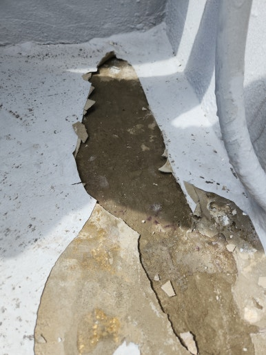
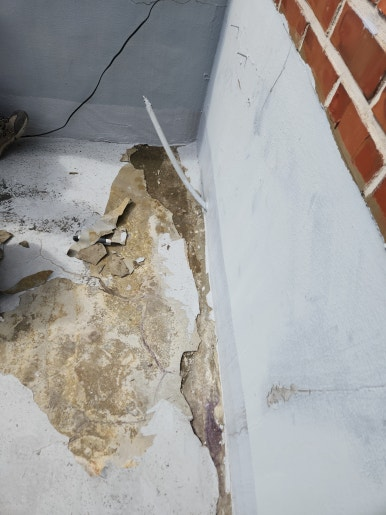
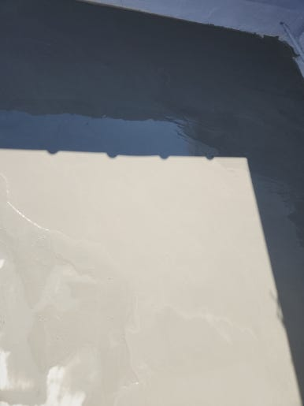
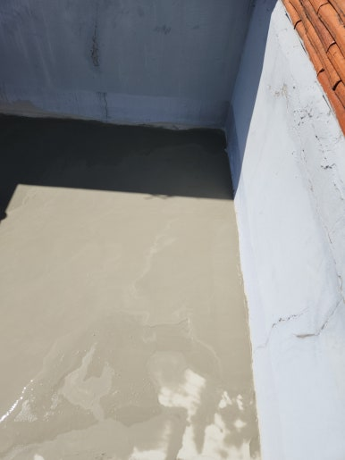

주택, 아파트, 공장, 상가 등 각종 시설물 보수부터 옥상 방수, 외벽 보수, 누수 공사까지 현장 상태에 맞춰 문제를 확실하게 해결해 드리는 집수리남입니다.

오늘은 대구 북구 주택 옥상 방수 시공 현장, 기존 방수층 제거 및 재시공과 배수구 주변 틈새 보강 작업을 소개해 드리겠습니다.  기존 방수층의 들뜸과 접착력 저하, 배수구 주변 틈새 갈라짐으로 누수가 우려되어 노후 방수층을 제거하고 재시공 및 방수 보강을 진행한 현장입니다.

옥상은 비와 눈, 강한 햇빛에 직접 노출되어 방수층이 노후되기 쉬우며, 특히 배수구 주변은 빗물이 집중되는 부위이기 때문에 작은 틈새 손상도 누수로 이어질 수 있습니다. 방수층 손상이 심한 경우 부분 보수보다 불량 방수층 제거 후 바탕면을 정리해 새롭게 재시공하는 것이 중요합니다.

<h2>이런 이유로 작업을 진행했습니다</h2>

- 기존 옥상 방수층이 들뜨고 벗겨진 경우
 
- 방수층 접착력이 떨어져 들뜸 현상이 발생한 경우
 
- 배수구 주변 이음새가 갈라지거나 벌어진 경우
 
- 비가 많이 내리면 옥상 바닥에 물이 고이는 경우
 
- 옥상 방수 기능 저하로 누수가 우려되는 경우

<h2>옥상 방수 재시공 및 배수구 틈새 보수 작업 과정</h2>

1. 현장 점검 (기존 방수층 들뜸 및 배수구 주변 손상 상태 확인)
 
2. 기존 방수층 제거 (들뜨고 접착력이 떨어진 불량 방수층 제거)
 
3. 바탕면 정리 (잔여 방수재와 이물질 제거 및 시공면 청소)
 
4. 옥상 방수 재시공 (정리된 바탕면에 방수층 재시공 및 배수구 주변 틈새 보수)
 
5. 마감 및 점검 (방수 마감 상태와 배수구 주변 틈새 확인)

이번 작업은 약 5시간 내외 소요되어
당일 작업을 완료하였습니다.

<h2>작업 후 개선 효과</h2>

✔ 들뜨고 손상된 기존 방수층 정비 
✔ 노후 방수층 제거 후 새로운 방수층 시공 
✔ 옥상 바닥 방수 기능 개선 
✔ 배수구 주변 갈라진 틈새 보수 
✔ 빗물 유입 취약 부위 방수 보강 
✔ 옥상 누수 및 추가적인 방수 손상 예방에 도움

<h2>이런 경우 옥상 방수 점검이 필요합니다!</h2>

✔ 옥상 바닥 방수층이 들뜨거나 벗겨진 경우 
✔ 기존 방수층 표면에 갈라짐이 발생한 경우 
✔ 배수구 주변 틈새가 갈라지거나 떨어진 경우 
✔ 비가 온 뒤 옥상에 물이 고이거나 배수가 원활하지 않은 경우 
✔ 아래층 천장이나 벽면에 누수 흔적이 발생한 경우 
✔ 오래된 주택으로 옥상 방수 재시공이 필요한 경우

<h3 style="margin:0 0 12px 0;">
📌 더 자세한 시공 사례
</h3>

시공 과정과 작업 전후 사진은
네이버 블로그에서
더 자세하게 확인하실 수 있습니다.

<a href="https://blog.naver.com/house_surri/224490542577"
target="_blank"
rel="noopener"
style="
display:inline-block;
background:#03C75A;
color:#fff;
text-decoration:none;
padding:12px 22px;
border-radius:8px;
font-weight:700;">
네이버 블로그에서 자세히 보기 →
</a>

<h2>시공 문의 안내</h2>

옥상 방수 재시공 / 기존 방수층 제거 / 주택 옥상 방수 / 배수구 주변 틈새 보수 / 옥상 누수 점검 / 방수 하자 보수

전화 • 문자 • 카톡

편하게 문의하세요!

