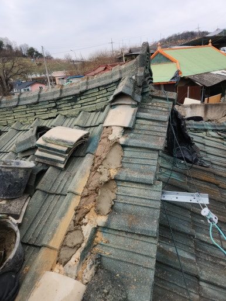
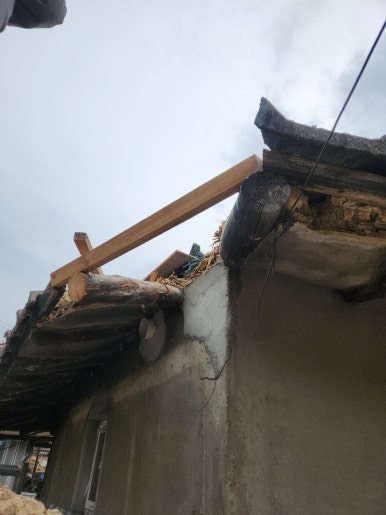
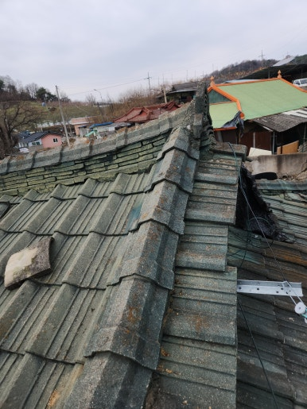
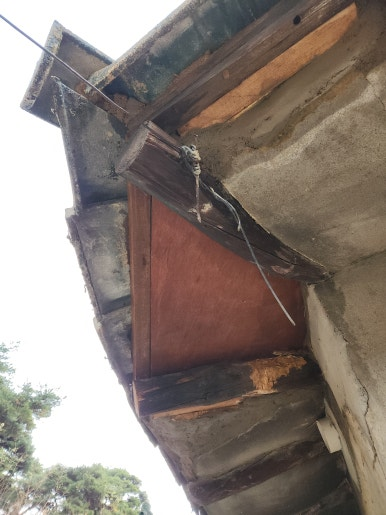

주택, 아파트, 공장, 상가 등 각종 시설물 보수부터 지붕 방수, 외벽 보수, 누수 공사까지 현장 상태에 맞춰 문제를 확실하게 해결해 드리는 집수리남입니다.

오늘은 대구 달성군 주택 기와지붕 처마 및 용마루 수리 현장을 소개해 드리겠습니다.  오랜 시간 외부 환경에 노출되어 처마와 용마루 주변의 노후 및 손상이 확인되었으며, 기와 밀림과 마감 부위 벌어짐으로 인한 누수 및 기와 이탈을 예방하기 위해 보수 작업을 진행한 현장입니다.

기와지붕은 작은 손상이라도 방치하면 주변 기와와 마감 부위까지 추가적인 문제가 발생할 수 있습니다. 특히 처마와 용마루는 지붕의 끝부분과 상단 연결 부위를 마감하여 빗물 유입을 막는 중요한 역할을 하는 만큼, 손상된 부분을 정확히 확인해 보수하는 것이 중요합니다.

<h2>이런 이유로 작업을 진행했습니다</h2>

- 주택 기와지붕 처마 부분이 노후되거나 손상된 경우
 
- 용마루 주변 마감재가 갈라지거나 떨어진 경우
 
- 기와가 밀리거나 들떠 고정 상태가 불량한 경우
 
- 강한 바람이나 비로 기와 이탈이 우려되는 경우
 
- 지붕 연결 부위의 틈새로 누수 가능성이 있는 경우

<h2>기와지붕 처마 및 용마루 수리 작업 과정</h2>

1. 현장 점검 (처마 및 용마루 손상 상태 확인)
 
2. 불량 부위 정리 (노후된 마감재와 손상 부위 정비)
 
3. 기와 상태 확인 (밀리거나 들뜬 기와 위치 및 고정 상태 점검)
 
4. 처마 및 용마루 보수 (손상 부위 보강 및 마감 작업 진행)
 
5. 마감 및 점검 (전체 시공 상태와 기와 고정 상태 확인)

이번 작업은 약 6~7시간 내외 소요되어
당일 작업을 완료하였습니다.

<h2>작업 후 개선 효과</h2>

✔ 노후되고 손상된 처마 부분 정비 
✔ 용마루 주변 불량 마감 보수 
✔ 기와지붕 연결 부위 보강 
✔ 기와의 들뜸 및 이탈 위험 개선 
✔ 빗물 유입 취약 부위 보수 
✔ 지붕의 유지관리 및 추가 손상 예방에 도움

<h2>이런 경우 점검이 필요합니다!</h2>

✔ 처마 끝부분의 기와가 깨지거나 밀린 경우 
✔ 용마루 주변 마감재가 갈라지거나 떨어진 경우 
✔ 지붕 기와가 들뜨거나 고정 상태가 불안정한 경우 
✔ 비가 온 뒤 천장이나 벽면에 누수 흔적이 발생한 경우 
✔ 강풍이나 태풍 이후 지붕 손상이 의심되는 경우 
✔ 오래된 주택으로 기와지붕 보수가 필요한 경우

<h3 style="margin:0 0 12px 0;">
📌 더 자세한 시공 사례
</h3>

시공 과정과 작업 전후 사진은
네이버 블로그에서
더 자세하게 확인하실 수 있습니다.

<a href="https://blog.naver.com/house_surri/224491995571"
target="_blank"
rel="noopener"
style="
display:inline-block;
background:#03C75A;
color:#fff;
text-decoration:none;
padding:12px 22px;
border-radius:8px;
font-weight:700;">
네이버 블로그에서 자세히 보기 →
</a>

<h2>시공 문의 안내</h2>

기와지붕 처마 수리 / 용마루 보수 / 주택 기와지붕 수리 / 노후 기와 정비 / 지붕 마감 보수 / 기와 이탈 및 누수 점검

전화 • 문자 • 카톡

편하게 문의하세요!

