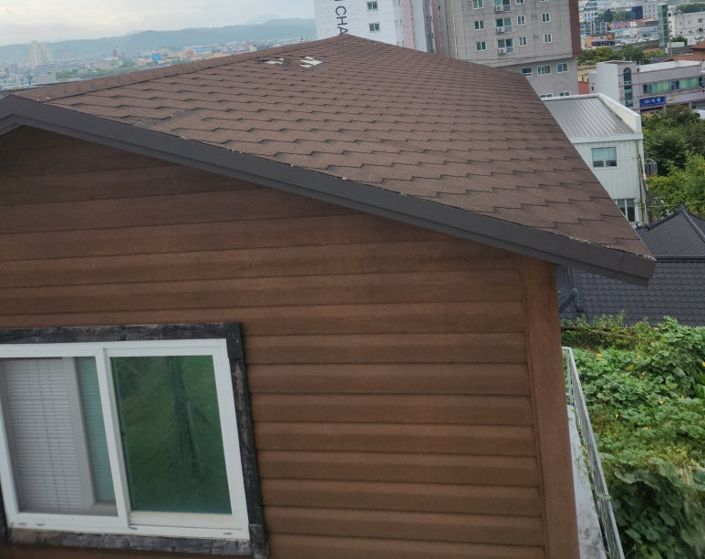
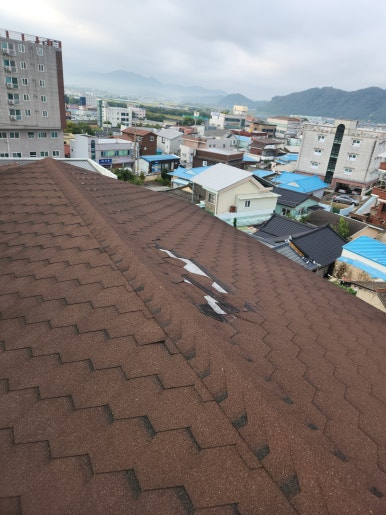
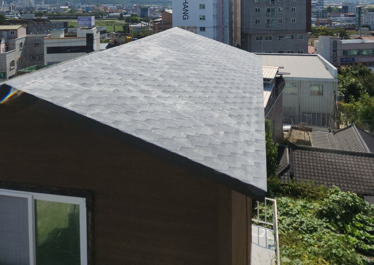
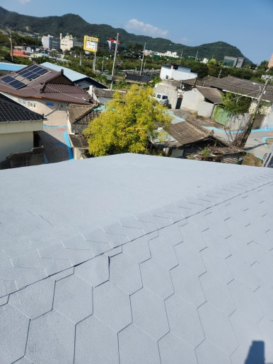

주택, 아파트, 공장, 상가 등 각종 시설물 보수부터 지붕 방수, 외벽 보수, 누수 공사까지 현장 상태에 맞춰 문제를 확실하게 해결해 드리는 집수리남입니다.

오늘은 대구 서구 슁글지붕 방수 페인트 도장 작업 현장을 소개해 드리겠습니다.  기존 지붕의 노후 상태를 꼼꼼하게 확인하고 도장 전 바탕면 정리 작업을 실시한 뒤, 방수 페인트를 도포하여 지붕 표면을 보호하고 유지관리 효과를 높인 현장입니다.

지붕은 일반 외벽과 달리 비와 직사광선을 직접적으로 받는 부분이기 때문에 도장 전 바탕면 정리와 꼼꼼한 시공이 중요합니다. 작은 손상이라도 장기간 방치하면 추가 보수 비용이 발생할 수 있으므로 정기적으로 점검하고 방수 작업을 진행하는 것이 좋습니다.

<h2>이런 이유로 작업을 진행했습니다</h2>

- 슁글지붕이 오래되어 표면이 노후된 경우
 
- 지붕 표면의 색상이 변색되고 오염된 경우
 
- 기존 방수 도막이 벗겨지거나 손상된 경우
 
- 비가 온 뒤 지붕 주변에 누수 흔적이 발생한 경우
 
- 지붕의 방수 성능을 보완하고 깔끔하게 정비하고 싶은 경우

<h2>슁글지붕 방수 페인트 도장 작업 과정</h2>

1. 현장 점검 (지붕 노후 상태 및 손상 부위 확인)
 
2. 바탕면 정리 (지붕 표면 오염물과 이물질 제거)
 
3. 보수 작업 (손상되거나 취약한 부위 정비)
 
4. 방수 페인트 도장 (지붕 전체 상태에 맞춰 꼼꼼하게 도포)
 
5. 마감 및 점검 (도장 상태와 마감 상태 최종 확인)

이번 작업은 약 5~6시간 내외 소요되어
당일 작업을 완료하였습니다.

<h2>작업 후 개선 효과</h2>

✔ 노후된 슁글지붕 표면 정비 
✔ 방수 페인트 도장을 통한 표면 보호 
✔ 외부 빗물과 습기에 대한 대응력 보완 
✔ 지붕의 외관 개선 및 깔끔한 마감 
✔ 자외선과 외부 환경으로 인한 지붕 손상 예방 
✔ 정기적인 지붕 유지관리 및 수명 관리에 도움

<h2>이런 경우 지붕 점검을 받아보세요!</h2>

✔ 슁글지붕이 오래되어 색이 바래고 낡은 경우 
✔ 지붕 표면이 갈라지거나 손상된 경우 
✔ 기존 방수 도장면이 벗겨지는 경우 
✔ 비가 올 때 지붕 주변으로 누수가 의심되는 경우 
✔ 강한 햇빛과 비바람으로 지붕 상태가 나빠진 경우 
✔ 노후 지붕의 방수 및 유지관리가 필요한 경우

<h3 style="margin:0 0 12px 0;">
📌 더 자세한 시공 사례
</h3>

시공 과정과 작업 전후 사진은
네이버 블로그에서
더 자세하게 확인하실 수 있습니다.

<a href="https://blog.naver.com/house_surri/224493466097"
target="_blank"
rel="noopener"
style="
display:inline-block;
background:#03C75A;
color:#fff;
text-decoration:none;
padding:12px 22px;
border-radius:8px;
font-weight:700;">
네이버 블로그에서 자세히 보기 →
</a>

<h2>시공 문의 안내</h2>

슁글지붕 방수 및 도장 작업 / 주택 지붕 방수 및 노후 보수 / 건물 지붕 누수 점검 및 표면 정비

전화 • 문자 • 카톡

편하게 문의하세요!

