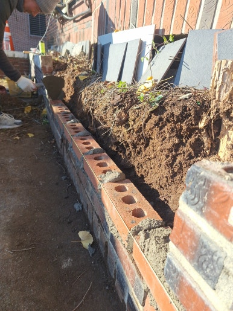
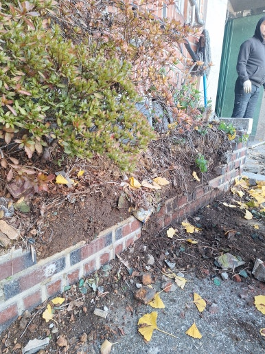
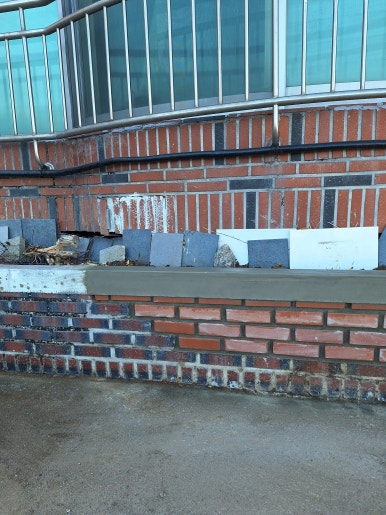
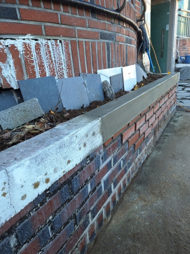

주택, 아파트, 공장, 상가 등 각종 시설물 보수부터 벽돌 조적, 화단 시공, 외벽 보수, 방수 공사까지 현장 상태에 맞춰 문제를 확실하게 해결해 드리는 집수리남입니다.

오늘은 대구 달서구 연립주택 적벽돌 화단 테두리 보수 작업 현장을 소개해 드리겠습니다.  기존 적벽돌 화단 테두리 일부가 파손된 상태를 확인하고 손상 부위를 정리한 뒤, 적벽돌 조적 및 줄눈 마감으로 기존 화단과 자연스럽게 어우러지도록 보수한 현장입니다.

화단 테두리의 작은 파손도 장기간 방치하면 주변 벽돌까지 영향을 줄 수 있습니다. 따라서 손상된 부분을 확인하고 필요한 구간을 적절하게 보수하여 화단의 형태와 외관을 유지하는 것이 좋습니다.

<h2>이런 이유로 작업을 진행했습니다</h2>

- 적벽돌 화단 일부가 깨지거나 파손된 경우
 
- 벽돌 사이 모르타르가 떨어져 나간 경우
 
- 화단 테두리가 흔들리거나 틈이 발생한 경우
 
- 기존 화단의 외관이 노후되고 지저분해진 경우
 
- 화단 모서리나 가장자리 부분이 손상된 경우
 
- 파손된 부분만 부분적으로 보수하고 싶은 경우

<h2>적벽돌 화단 테두리 보수 작업 과정</h2>

1. 현장 점검 (파손된 벽돌과 주변 상태 확인)
 
2. 손상 부위 정리 (깨진 벽돌과 기존 모르타르 제거)
 
3. 바탕면 정비 (새로운 벽돌 시공을 위한 작업면 정리)
 
4. 적벽돌 조적 (기존 화단 형태에 맞춰 벽돌 보수 시공)
 
5. 줄눈 및 마감 (모르타르 정리와 전체 마감 상태 확인)

이번 작업은 약 5시간 내외 소요되어
당일 작업을 완료하였습니다.

<h2>작업 후 개선 효과</h2>

✔ 파손된 적벽돌 화단 테두리 복구 
✔ 손상된 벽돌 부분 정비 및 보수 
✔ 화단 가장자리의 깔끔한 형태 개선 
✔ 기존 화단과 조화를 이루는 자연스러운 마감 
✔ 추가적인 벽돌 손상 예방에 도움 
✔ 주택 외부 공간의 전체적인 미관 개선

<h2>이런 경우 점검을 받아보세요!</h2>

✔ 적벽돌이 깨지거나 떨어져 나간 경우 
✔ 화단 가장자리에 균열이 발생한 경우 
✔ 벽돌 사이 모르타르가 탈락한 경우 
✔ 오래된 화단 테두리가 지저분해진 경우 
✔ 부분적인 벽돌 보수로 화단을 정비하고 싶은 경우

<h3 style="margin:0 0 12px 0;">
📌 더 자세한 시공 사례
</h3>

시공 과정과 작업 전후 사진은
네이버 블로그에서
더 자세하게 확인하실 수 있습니다.

<a href="https://blog.naver.com/house_surri/224494843333"
target="_blank"
rel="noopener"
style="
display:inline-block;
background:#03C75A;
color:#fff;
text-decoration:none;
padding:12px 22px;
border-radius:8px;
font-weight:700;">
네이버 블로그에서 자세히 보기 →
</a>

<h2>시공 문의 안내</h2>

적벽돌 화단 테두리 부분 보수 / 주택 외부 화단 벽돌 조적 작업 / 파손된 벽돌 및 모르타르 보수 / 각종 주택 외부 시설물 보수 및 정비

전화 • 문자 • 카톡

편하게 문의하세요!

