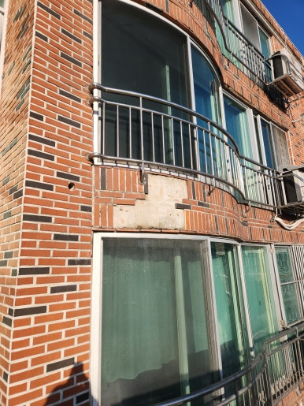
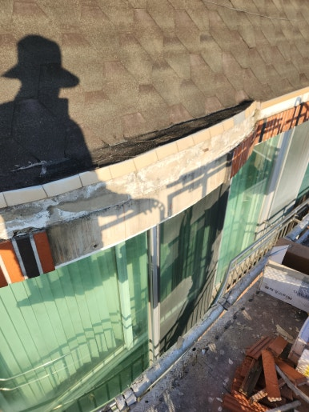
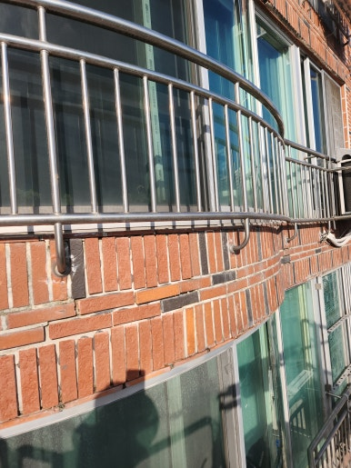
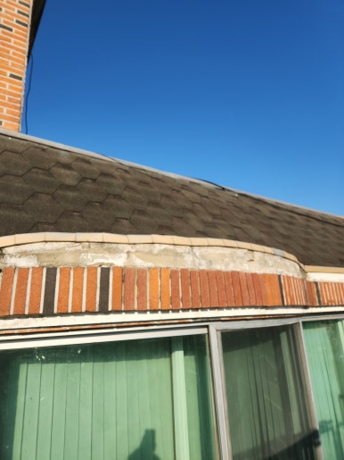

주택, 아파트, 공장, 상가 등 각종 시설물 보수부터 벽돌 조적, 화단 시공, 외벽 보수, 방수 공사까지 현장 상태에 맞춰 문제를 확실하게 해결해 드리는 집수리남입니다.

오늘은 대구 달성군 빌라 현장에서 진행한 들뜨고 노후된 외벽 타일 부분 보수 작업 현장을 소개해 드리겠습니다.  오랜 시간 외부 환경에 노출되어 들뜨고 노후된 타일 상태를 확인하고 기존 타일을 정리한 뒤, 주변 외벽과 자연스럽게 어우러지도록 부분 보수한 현장입니다.

외벽 타일의 작은 들뜸이나 균열도 장기간 방치하면 주변 타일까지 영향을 줄 수 있습니다. 따라서 손상 범위를 확인하고 필요한 부분부터 적절하게 보수하여 건물 벽면 보호와 외관을 유지하는 것이 좋습니다.

<h2>이런 이유로 작업을 진행했습니다</h2>

- 외벽 타일이 벽면에서 들떠 있는 경우
 
- 오래된 타일 표면이 깨지거나 균열이 발생한 경우
 
- 타일 일부가 떨어져 나간 경우
 
- 타일 사이 줄눈이 갈라지거나 탈락한 경우
 
- 외벽 타일의 접착력이 약해진 경우
 
- 전체 교체 없이 손상된 부분만 보수하고 싶은 경우

<h2>외벽 타일 부분 보수 작업 과정</h2>

1. 현장 점검 (들뜬 타일과 노후된 외벽 상태 확인)
 
2. 손상 부위 제거 (들뜨고 파손된 기존 타일 제거)
 
3. 바탕면 정리 (기존 접착 잔여물 제거 및 벽면 정비)
 
4. 타일 부분 시공 (접착제를 사용해 손상 구간 타일 보수)
 
5. 줄눈 및 마감 (줄눈 정리와 주변 외벽 마감 상태 확인)

이번 작업은 약 6시간 내외 소요되어
당일 작업을 완료하였습니다.

<h2>작업 후 개선 효과</h2>

✔ 들뜨고 노후된 외벽 타일 부분 보수 
✔ 손상된 타일 제거 및 외벽 바탕면 정비 
✔ 타일 접착 상태 개선 
✔ 외벽 타일의 들뜸 및 탈락 위험 예방에 도움 
✔ 주변 타일과 조화를 이루는 깔끔한 마감 
✔ 빌라 외벽의 전체적인 외관 개선

<h2>이런 경우 점검을 받아보세요!</h2>

✔ 외벽 타일이 벽면에서 들뜨는 경우 
✔ 오래된 외벽 타일이 깨지거나 떨어진 경우 
✔ 타일 사이 줄눈이 갈라진 경우 
✔ 외벽 타일 표면이 노후되고 지저분해진 경우 
✔ 타일 일부만 교체하거나 부분 보수가 필요한 경우

<h3 style="margin:0 0 12px 0;">
📌 더 자세한 시공 사례
</h3>

시공 과정과 작업 전후 사진은
네이버 블로그에서
더 자세하게 확인하실 수 있습니다.

<a href="https://blog.naver.com/house_surri/224495814839"
target="_blank"
rel="noopener"
style="
display:inline-block;
background:#03C75A;
color:#fff;
text-decoration:none;
padding:12px 22px;
border-radius:8px;
font-weight:700;">
네이버 블로그에서 자세히 보기 →
</a>

<h2>시공 문의 안내</h2>

외벽 타일 들뜸 및 파손 부분 보수 / 빌라 및 주택 외벽 타일 교체 작업 / 노후된 외벽 타일 정비 및 보수 / 외벽 균열 및 각종 시설물 보수

전화 • 문자 • 카톡

편하게 문의하세요!

